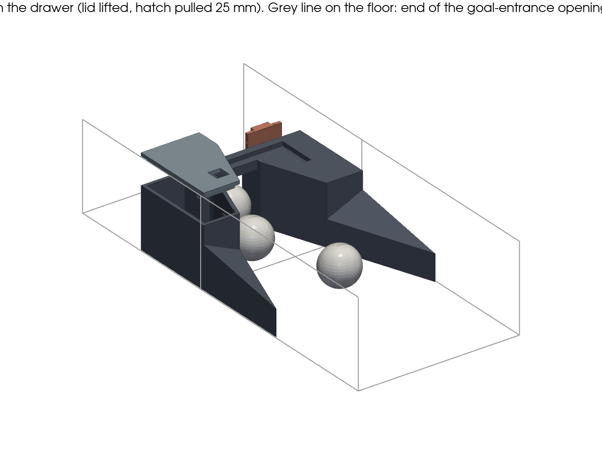
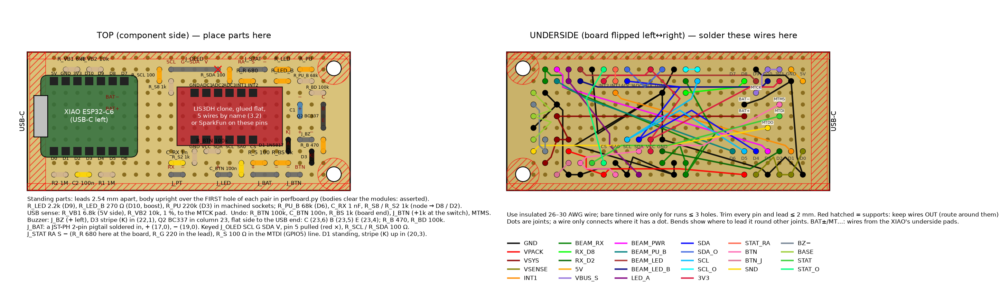
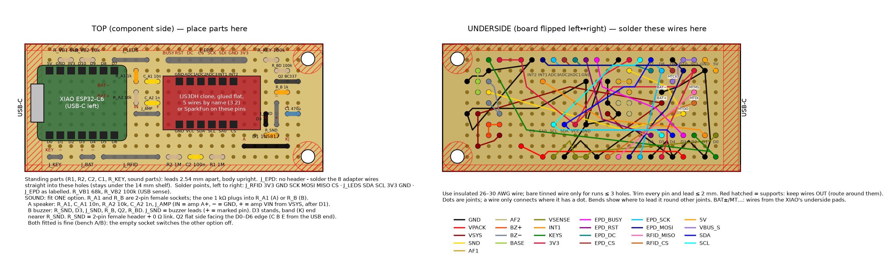
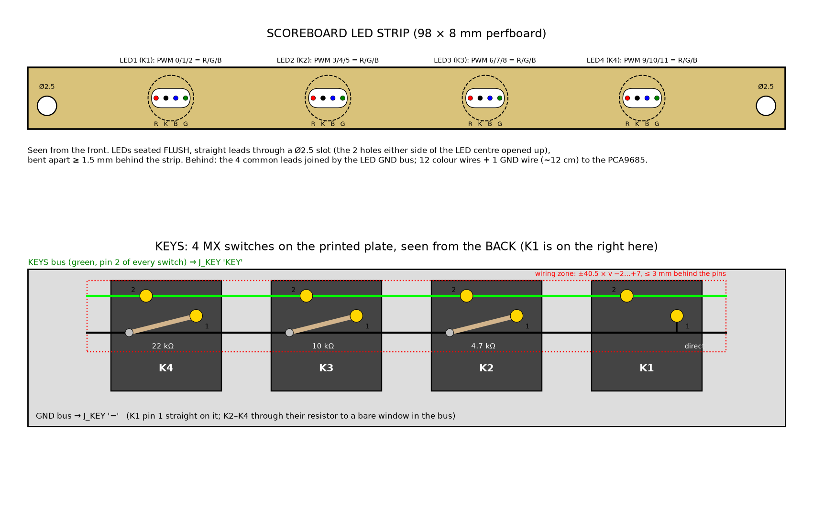

# Building a goal counter

This guide takes you from parts on the table to a device in the goal drawer that counts goals.
Every goal gets its own device, so a table needs **two**.

Each device has three parts:
- **a 3D-printed insert** that sits in the ball drawer and funnels every ball through a narrow gate;
- **an invisible infrared beam** across that gate, with an IR LED on one side and an IR sensor on the
  other. A ball breaks the beam, and that is a goal;
- **a small electronics board** on 3 × AA batteries. It sleeps until somebody starts playing (it feels the
  table move), counts goals and sends them over Wi-Fi.

---

## Before you start

### Do I need to solder? Yes, about 200 joints per device

The parts are off-the-shelf modules, but they ship with loose pins. A foosball table shakes hard,
and push-in breadboards or jumper wires work loose, so everything on the board is soldered.

| Where | Joints | Difficulty |
|---|---|---|
| Pin headers on the XIAO (2 × 7, pre-soldered on the XIAO: 14 into the perfboard) and the accelerometer (2 × 6 × 2) | 38 | Easy: through-hole, the same joint over and over |
| Resistors, capacitors, 2 diodes, a transistor, 7 headers, the resistor socket | ~62 | Easy |
| **Battery and back-pad wires onto the XIAO's pads** (BAT+, BAT−, MTCK, MTMS, MTDO, MTDI, underneath) | 6 | **The fiddly part**: small flat pads. Tips in step 3.4 |
| Wires on the underside of the board | ~60 | Easy, just take your time |
| Leads: LED (+ 47 Ω), sensor, extension, battery lead, button (+ 1 k), buzzer, status LEDs (+ 2 resistors) | ~22 | Easy, plus heat-shrink |

**Skill level:** if you have soldered a few through-hole joints before, you can build this. If you have
never soldered, practise 20 joints on a spare piece of perfboard first.

**Time per device:**

| Task | First unit | Later units |
|---|---|---|
| 3D printing (runs unattended) | ~5–7 h | ~5–7 h |
| Building the electronics | ~2.5 h | ~1.5 h |
| Flashing and testing | ~30 min (+ ~10 min one-off download on the first build) | ~10 min |
| Fitting into the insert and the drawer | ~30 min | ~20 min |

Plan one afternoon for the first table and about an hour of hands-on time for each table after that.

### Tools

| Tool | Notes |
|---|---|
| Temperature-controlled soldering iron, fine conical or small chisel tip | ~330 °C for leaded solder, ~360 °C for lead-free |
| Solder, 0.5–0.8 mm, rosin core | 60/40 or 63/37 leaded is easiest for beginners; lead-free works too |
| Flux pen | Makes the BAT pads and the headers much easier |
| Side cutters (flush cut) | To trim leads |
| Wire stripper for 26–30 AWG | |
| Desoldering braid | To fix mistakes |
| Helping hands or a small vice | |
| **Digital multimeter** | Needed for the bench test. Ideally it has a µA range |
| **Current-limited bench supply** | First power at a 100 mA limit, and the low-battery gate (review 2) |
| **Oscilloscope** (borrowed is fine) | The 3V3 dip at the cutoff during TX, beam edges, I²C rise time |
| Superglue, fine marker | Key cavities in the housings; labels on the board |
| Utility knife + steel ruler | To cut the perfboard |
| Drill (hand drill is fine) with a **3.2 mm** bit | For the 2 locating-pin holes |
| Heat gun or lighter | For heat-shrink |
| Laptop + **slim** USB-C **data** cable | For flashing through the drawer lane (plug body ≤ 13 × 8 mm) |
| Bambu Lab printer (A1 / P1S / X1C) | For the insert |

Safety: solder in a ventilated room and wash your hands afterwards (especially with leaded solder).
Wear glasses when you cut leads, because they fly.

### Parts

Generated from the counted cart in **[electronics/bom.md](electronics/bom.md)** (review 2, exact part numbers there).
For **each device**, put these on the table:

- [ ] Seeed **XIAO ESP32-C6, pre-soldered headers** (SKU 102010636)
- [ ] **SparkFun SEN-13963** LIS3DH (first table; a clone later, step 3.2)
- [ ] **TSAL6200** IR LED + **R_LS 47 Ω**; **TEFT4300** IR sensor
- [ ] **1N5817** × 2 (D1, D3), **C1** Rubycon 10YXJ470M6.3X11 (the one with the lowest leakage from your screened four),
  **100 nF** × 2, **1 nF** × 1
- [ ] Resistors, **1 % metal film**: **R_BS 1 kΩ** (button, board end), 2 × **1 MΩ**, **2.2 kΩ** (R_LED), **270 Ω** (R_LED_B), **220 kΩ** (R_PU), **68 kΩ**
  (R_PU_B), **6.8 kΩ** + **10 kΩ** (USB sense), 2 × **100 kΩ** (R_BTN, R_BD), 3 × **1 kΩ** (R_S8, R_S2, the switch's
  inline 1 k), **470 Ω** (R_B), 3 × **100 Ω** (R_S, R_SCL, R_SDA), **680 Ω** + **220 Ω** (R_R on the board, R_G inline). Spares
  for calibration: 1 kΩ, 470 Ω, 470 kΩ, 100 kΩ (beam); 470 Ω, 1 kΩ, 150 Ω, 330 Ω (status LEDs)
- [ ] Same Sky **CMT-1209-390T** buzzer, onsemi **BC33740TA**
- [ ] Cherry **MX1A-E1NN** (plate-mount MX blue) + mechanical's printed 10 × 10 cap
- [ ] **Waveshare 14657** 0.91" OLED; Kingbright **WP710A10ZGDK** (green) + **WP710A10SURDK** (red)
- [ ] Perfboard 50 × 70 mm, double-sided
- [ ] Male header strip (**19 pins**: J_PT, J_LED, J_BTN, J_BZ 2 each; J_STAT 3, J_OLED 5, the mouth joint 3; J_BAT is a JST pigtail),
  machined socket strip (**6 pins**: R_LED, R_LED_B, R_PU)
- [ ] **19** Adafruit F–F jumpers (30 cm) and housings: 4 × 2-pin, 2 × 3-pin (sensor, J_STAT), 1 × 5-pin (OLED);
  28–30 AWG insulated wire for the underside; heat-shrink 1.5–2.5 mm; superglue (key cavities)
- [ ] **DFRobot FIT0610** 3 × AA holder (the only one that fits the drawer) + 3 × **AA NiMH** (own, matched, charged)
- [ ] **Adafruit 1131** JST-PH cable (one, cut in half: the J_BAT pigtail and the battery lead's plug), an **F1 2 A pico
  fuse** (Littelfuse 0251002.MXL), and a
  **2-wire strip of Adafruit 6181** silicone ribbon, ≈ 260 mm (the battery's slack-loop lead)
- [ ] Bought ahead, fitted only if the in-table RSSI test fails: Molex **146153-0100** U.FL antenna
- [ ] Mechanical's printed sled, drawer, dash and lid, hot glue ([mechanical/SLED-ASSEMBLY.md](mechanical/SLED-ASSEMBLY.md) §3)

---

## 1. Print the insert first

Printing takes hours, so start it now and build the electronics while it runs. Follow mechanical's
**[SLED-ASSEMBLY.md](mechanical/SLED-ASSEMBLY.md)** §2 *Print*.

## 2. Cut and drill the perfboard

The board is **70 × 30 mm**, cut from a 50 × 70 mm protoboard. Here is the layout you will build. On the
left is the **top** (parts side). On the right is the **underside**, mirrored exactly as you see it when
you flip the board over:

1. Keep the two **70 mm factory edges**. One of them becomes the **bottom edge**, where the three small
   headers go.
2. Measure **30 mm** up from the bottom edge and mark a line, which falls between two hole rows.
   Score it hard with the utility knife along the steel ruler, 5–6 passes on **both** sides. Then snap
   it over a table edge. Sand the edge smooth.
3. Hold it the way the picture shows. **Hole column 1 is the column closest to the left edge** (about
   5.8 mm from it), and **hole row 1 is the row closest to the bottom edge**.
4. Drill **2 holes, 3.2 mm**, **3.5 mm** from the **right** edge and 3.5 mm from the bottom and top
   edges. **One** printed pin goes through the bottom hole; the top hole rests on a round boss (no pin), and the
   left end of the board rests on flat pads.

> Positions in this guide are given as (column, row), counting from 1. The picture is the reference;
> when in doubt, count holes on the picture.

## 3. Build the electronics board

Solder the low parts first and the tall ones last, so the board lies flat while you work.

### 3.1 Small parts (top side)

Push each part in from the **top**, bend the leads slightly on the underside so it can't fall out,
solder, then trim.

> **Trim everything to ≤ 2 mm under the board:** every lead and every header pin, in 3.1, 3.2 and 3.5.
> The board rests on printed supports, and anything longer stops it seating, so the accelerometer
> would rock. Check every part against the top view of the picture.

| Part | Holes (column, row) | How |
|---|---|---|
| **R2 1M** | (1,1)–(2,1) | Either way |
| **C2 100n** | (3,1)–(4,1) | Either way |
| **R1 1M** | (5,1)–(6,1) | Either way |
| **J_PT** | (11,1)–(12,1) | Pins up. **RX** (11,1), **−** (12,1) |
| **J_LED** | (15,1)–(16,1) | Pins up. **A** (15,1), **−** (16,1) |
| **J_BAT** | (18,1)–(20,1) | **JST-PH 2-pin pigtail** (the socket half of an Adafruit 1131 cable) soldered in: **red +** (18,1), **black −** (20,1); hole (19,1) stays empty. Meter its polarity first (step 4.4) |
| **D1 1N5817** | (21,3)–(21,4) | Standing, body over (21,3), **stripe (cathode) up into (21,4)** |
| **C1** | (22,6)–(22,7) | Standing: **+ (long lead) (22,6)**, − (stripe) (22,7). Wrong way round it can burst |
| **R_LED** | (20,10)–(21,10) | Machined socket 1 × 2 (part of the 1 × 4 strip on this row) |
| **R_PU** | (22,10)–(23,10) | Machined socket (the strip's right half) |
| **R_LED_B** | (20,9)–(21,9) | Machined socket 1 × 2, right under R_LED |
| **R_PU_B 68k** | (22,9)–(23,9) | Standing, body over (22,9). Beam pull-up B (daylight mode) |
| **C_RX 1n** | (11,2)–(12,2) | Either way, right above J_PT |
| **R_S8 1k** | (11,9)–(11,8) | Standing, body over (11,9). Beam node → D8 |
| **R_S2 1k** | (13,2)–(13,3) | Standing, body over (13,2). Beam node → D2 |
| **R_VB1 6k8** | (2,10)–(3,10) | Standing. USB sense, 5V side |
| **R_VB2 10k** | (4,10)–(5,10) | Standing |
| **R_BTN 100k** | (15,3)–(14,3) | Standing, body over (15,3). Undo-button pull-up |
| **C_BTN 100n** | (17,1)–(17,2) | Either way, between J_LED and J_BAT |
| **J_BTN** | (21,1)–(22,1) | Pins up. **−** (21,1), **BTN** (22,1) |
| **R_BS 1k** | (20,2)–(21,2) | Standing, body over (20,2). 1 kΩ at the board end of the button lead |
| **J_BZ** | (22,4)–(23,4) | Pins up. **+** (22,4), **−** (23,4) |
| **D3** | (23,2)–(23,3) | Standing, body over (23,2), **stripe (cathode) into (23,2)**. The buzzer's flyback diode |
| **R_BD 100k** | (24,8)–(23,8) | Standing, body over (24,8). Keeps the buzzer silent at boot |
| **Q2 BC337** | (24,7)–(24,5) | Standing in a column, **flat side towards the USB end**: C (24,7), B (24,6), E (24,5) |
| **R_B 470** | (24,3)–(24,4) | Standing, body over (24,3) |
| **J_OLED** | (11,10)–(15,10) | **5-pin header, pull out pin 5** at (15,10) (the key). **SCL** (11,10), **G**, **SDA**, **V** to the right |
| **R_SCL 100** | (10,9)–(10,10) | Standing, body over (10,9) |
| **R_SDA 100** | (16,10)–(16,9) | Standing, body over (16,10) |
| **J_STAT** | (17,10)–(19,10) | Pins up. **RA** (17,10) (red anode, through R_R), **S** (18,10), **−** (19,10) |
| **R_S 100** | (18,2)–(19,2) | Standing, body over (18,2). In the GPIO5 (MTDI) line |
| **R_R 680** | (17,9)–(18,9) | Standing, body over (17,9). The red status LED's resistor, at the board end of its lead |

The table is generated from `electronics/perfboard.py` (`python assembly_tables.py`), so it matches the picture.
"Standing" means the part is upright: its body sits over the first hole listed, one lead goes straight down,
the other bends over the top and down into the next hole. **Keyed header:** cut J_OLED from the strip as 5 pins and
pull pin 5 out with pliers before soldering (red × in the picture). **J_BAT** is no header: the JST-PH pigtail's two
wires go straight into its holes.

Write on the board with a marker, next to the headers, as in the picture: **RX −**, **A −**, **+ −** (J_BAT), **− BTN**, **+ −** (J_BZ), **SCL G SDA V** and **RA S −**.

Every part body clears the two modules and the others (`perfboard.py` asserts it, review 2): the buzzer
driver (Q2, R_BD, R_B, D3) sits right of the LIS3DH outline, never under it.

### 3.2 The accelerometer (LIS3DH)

**First table: the SparkFun SEN-13963** (review 2, lead: a documented board for the reference build); its steps
are at the end of this section. **Later units: a cheap LIS3DH clone**, wired **by pin name** as below, once a
SparkFun unit works.

1. **Check the chip.** The small square chip must be marked **C3H** (LIS3DH). Some listings say
   "LIS3DSH LIS3DH": a LIS3DSH (another marking) does not work with this firmware. Use another board.
2. **Prepare the clone** (do this before it goes onto the perfboard):
   - Don't fit its pin header.
   - If it has a **power LED**, remove it: warm it with the iron and flick it off. An LED would waste
     ~1 mA all the time.
   - Bridge its **CS** pin to its **VCC** pin with a short wire. CS high selects I²C. Leave **SDO**
     free; firmware finds the board at 0x18 or 0x19 by itself.
   - Power pin: if the board has both **VIN** (or 5V) and a **3.3V / 3Vo** pin, use **3.3V / 3Vo**.
     That skips its regulator. If it has only VCC: follow the trace. VCC straight to the chip (no
     regulator) is fine; VCC through a regulator is not (it fails the sleep-current check): use another
     clone or the SparkFun.
3. **Solder 5 thin wires (~4 cm) to the clone, from the top:** VCC (or 3.3V), GND, SDA, SCL, INT1.
4. **Push each wire down into its hole by name** and solder it on the underside (the hole's underside
   wire joins it later, in 3.6):

   | Clone pin | Hole (the picture's LIS3DH labels) |
   |---|---|
   | VCC / 3.3V | **VCC** (14,4) |
   | GND | **GND** (13,4) |
   | SDA | **SDA** (15,4) |
   | SCL | **SCL** (16,4) |
   | INT1 | **INT1** (17,8) |

   Trim the wires on the underside to ≤ 2 mm. All other clone pins stay free.
5. **Glue it flat, chip side up,** inside the red LIS3DH outline of the picture, with a blob of hot
   glue. It may cover holes there; that's fine. Use glue, not foam tape: the accelerometer has to feel
   the table, not float on foam. Tuck the 5 wires under its edge.

**First table, SparkFun SEN-13963:**
1. Make sure the little solder jumper **SJ1** on its back is **open** (not bridged). That gives address
   0x19.
2. Push the two 6-pin male headers into the perfboard at **columns 13–18, rows 4 and 8** (long pins
   down). Lay the board on top, **chip side up**. The row labelled **GND VCC SDA SCL SA0 CS** goes
   towards the **bottom** edge, with **GND on the left**.
3. Solder all 12 pins on top, then all 12 on the underside, and **cut the pins to ≤ 2 mm**. All 12
   joints hold it rigid, even the unused pins.

### 3.3 The capacitor (tall, do it after the LIS3DH)

**C1**, standing: **+ (the long lead)** goes in hole (22,6), and **− (the stripe on the can)** in (22,7). The
wrong way round, it can burst, so double-check. Then a dab of hot glue between the can and the board (it is
the tallest part on two thin leads, and the table shakes).

### 3.4 Battery and back-pad wires on the XIAO (the fiddly bit)

The XIAO's battery input is two small pads on its **underside**, near the end **opposite** the USB-C
port. They are marked **BAT+** and **BAT−**, or **+** and **−**, depending on the batch.
**Check with the multimeter (continuity): BAT− beeps to the GND pin.**

1. Cut two 6 cm pieces of thin insulated wire, **red** and **black**, and strip 2 mm off each.
2. Put flux on the pads. Tin each pad with a small blob of solder, and tin the wire ends.
3. Lay the red wire on BAT+ and touch it with the iron for 1–2 s until the blob melts around the
   wire. Do the same with black on BAT−.
4. Tug gently: the wire must not move. Run the wires flat towards the middle of the board, between the
   two pin rows, and anchor each wire's **jacket** (not the joint) to the XIAO's underside with a small dab of hot glue
   a few mm from its pad, so a tug on the wire can't lift the pad.
5. **The MTCK wire (USB sense).** The same way, solder a 6 cm **purple** wire to the small pad marked
   **MTCK** on the XIAO's underside (Seeed's back-pad pinout; GPIO6). The USB-sense divider connects to
   it, as on the scoreboard. Check: it must **not** beep to GND or 3V3.
6. **The MTMS and MTDO wires (undo button, buzzer).** The same way, solder a 6 cm **pink** wire to the pad marked
   **MTMS** (GPIO4), a 6 cm **yellow** wire to **MTDO** (GPIO7) and a 6 cm **green** wire to **MTDI** (GPIO5, the status LEDs).
   Check: none of them beeps to GND, 3V3, the MTCK wire or each other.

### 3.5 The XIAO

The cart buys the XIAO with its headers **already soldered** (SKU 102010636).
1. Thread the red wire down through hole **(6,6)**, the black wire through hole **(6,7)**, the purple
   MTCK wire through hole **(5,8)**, the pink MTMS wire through **(3,7)**, the yellow MTDO wire through **(4,5)** and the
   green MTDI wire through **(3,6)**. These are under the XIAO, as marked **BAT+** / **BAT−** / **MTCK** / **MTMS** /
   **MTDO** / **MTDI** in the picture.
2. Push the XIAO's header pins into the perfboard at **columns 1–7, rows 3 and 9**, **component side up**, with the
   **USB-C port at the left edge** (pin **D0** at the bottom left, **5V** at the top left). The header's plastic sits on
   the board.
3. Solder the 14 pins on the underside and **cut them to ≤ 2 mm**. Keep the iron on each pin for no more than about 3 s.

### 3.6 Underside wiring

Flip the board. Wire it **net by net** using the underside picture. **Keep every wire out of the red
hatched areas**: those are where the insert's supports press on the board, so route around them. Each colour is one net: every dot of
that colour gets connected, in the order listed. Tick off each one. Use insulated wire; bare tinned wire
is fine only for runs of 1–3 holes.

| Net | Wire these points, run by run (1-based holes) |
|---|---|
| **GND** | XIAO BAT− wire (6,7) · XIAO GND · R2 (1,1) · C2 (4,1) · LIS3DH GND (13,4) · LIS3DH GND (13,8) · J_PT − (12,1) · J_LED − (16,1) · J_BAT − (20,1) · J_BTN − (21,1) ; R_VB2 (5,10) · XIAO GND ; J_PT − (12,1) · C_RX (12,2) ; J_LED − (16,1) · C_BTN (17,2) ; LIS3DH GND (13,8) · J_OLED G (12,10) ; LIS3DH GND (13,8) · J_STAT − (19,10) ; J_BTN − (21,1) · C1 − (22,7) ; C1 − (22,7) · Q2 E (24,5) ; C1 − (22,7) · R_BD (23,8) |
| **VPACK** | R1 (6,1) · J_BAT + (18,1) · D1 A (21,3) |
| **VSYS** | XIAO BAT+ wire (6,6) · C1 + (22,6) ; C1 + (22,6) · D1 K, stripe (21,4) · J_BZ + (22,4) ; J_BZ + (22,4) · D3 K, stripe (23,2) |
| **VSENSE** | XIAO D0 · R2 (2,1) · C2 (3,1) · R1 (5,1) |
| **INT1** | XIAO D1 · LIS3DH INT1 (17,8) |
| **BEAM_RX** | R_S8 (11,9) · J_PT RX (11,1) · R_PU (23,10) · R_PU_B (23,9) ; R_S2 (13,2) · C_RX (11,2) · J_PT RX (11,1) |
| **RX_D8** | XIAO D8 · R_S8 (11,8) |
| **RX_D2** | XIAO D2 · R_S2 (13,3) |
| **5V** | XIAO 5V · R_VB1 (2,10) |
| **VBUS_S** | XIAO MTCK wire (5,8) · R_VB2 (4,10) · R_VB1 (3,10) |
| **BEAM_PWR** | XIAO D3 · R_PU (22,10) |
| **BEAM_PU_B** | XIAO D6 · R_PU_B (22,9) |
| **BEAM_LED** | XIAO D9 · R_LED (20,10) |
| **BEAM_LED_B** | XIAO D10 · R_LED_B (20,9) |
| **LED_A** | R_LED (21,10) · R_LED_B (21,9) · J_LED A (15,1) |
| **SDA** | XIAO D4 · LIS3DH SDA (15,4) ; LIS3DH SDA (15,4) · R_SDA (16,9) |
| **SDA_O** | R_SDA (16,10) · J_OLED SDA (13,10) |
| **SCL** | XIAO D5 · LIS3DH SCL (16,4) ; LIS3DH SCL (16,4) · R_SCL (10,9) |
| **SCL_O** | R_SCL (10,10) · J_OLED SCL (11,10) |
| **3V3** | XIAO 3V3 · LIS3DH VCC (14,4) ; LIS3DH VCC (14,4) · R_BTN (14,3) ; LIS3DH VCC (14,4) · J_OLED V (14,10) ; J_OLED V (14,10) · R_R (18,9) |
| **STAT_RA** | R_R (17,9) · J_STAT RA (17,10) |
| **BTN** | XIAO MTMS wire (3,7) · R_BTN (15,3) · R_BS (20,2) · C_BTN (17,1) |
| **BTN_J** | J_BTN BTN (22,1) · R_BS (21,2) |
| **SND** | XIAO MTDO wire (4,5) · R_B (24,3) |
| **BZ−** | J_BZ − (23,4) · D3 (23,3) · Q2 C (24,7) |
| **BASE** | R_B (24,4) · Q2 B (24,6) · R_BD (24,8) |
| **STAT** | XIAO MTDI wire (3,6) · R_S (19,2) |
| **STAT_O** | R_S (18,2) · J_STAT S (18,10) |

Nothing else connects. The LIS3DH's SA0, CS, ADC1-3 and INT2 stay free; XIAO D7 is free (no role strap since
review 2). **The beam node reaches D8 (counting) and D2 (health readings) each through its own 1 kΩ; USB sense
goes to the MTCK pad.** Each run is listed in wiring order; ";" starts a new run.

The full circuit is in [electronics/schematic.svg](electronics/schematic.svg), and the
wire-by-wire diagram in [electronics/wiring.svg](electronics/wiring.svg).

### 3.7 The calibration resistors

Plug them into the socket strip, standing, with the leads trimmed to about 6 mm:
- **R_LED 2.2 kΩ** into (20,10)–(21,10)
- **R_LED_B 270 Ω** (red-violet-brown) into (20,9)–(21,9)
- **R_PU 220 kΩ** into (22,10)–(23,10)

These are the knobs you may change in step 6. R_LED_B only lights the LED brighter in the server's
`a_boost` and `b` (daylight) beam modes; the default mode `a` uses R_LED and R_PU alone.

### 3.8 Inspect

- Look at every joint with a bright light: shiny, cone-shaped, and no solder bridging two holes.
- Multimeter in continuity mode, **no batteries in**:
  - [ ] J_BAT's pigtail: red (18,1) to black (20,1) does **not** beep; red beeps to R1 (6,1) and D1's anode (21,3);
  - [ ] XIAO 3V3 to GND does **not** beep;
  - [ ] J_BAT − to XIAO GND **beeps**;
  - [ ] XIAO D4 to LIS3DH SDA, and D5 to SCL, both **beep**; R_SDA / R_SCL read **100 Ω** to J_OLED SDA (13,10) / SCL (11,10);
  - [ ] the beam node: J_PT RX (11,1) reads **1 kΩ** to XIAO **D8** and **1 kΩ** to XIAO **D2**;
  - [ ] XIAO **D6** to R_PU_B (22,9), **D9** to socket (20,10) and **D10** to socket (20,9) each **beep**;
  - [ ] R_VB1 is **6.8 kΩ** (blue-grey-red) on the 5V side and R_VB2 **10 kΩ** (brown-black-orange); XIAO 5V
    beeps to R_VB1 (2,10), the MTCK wire (5,8) to the R_VB1/R_VB2 middle (3,10)–(4,10);
  - [ ] **Diode mode:** D1 reads ≈ 0.15–0.3 V with red on the anode (21,3), black on the stripe (21,4), and
    nothing the other way round;
  - [ ] J_BTN BTN (22,1) reads **1 kΩ** (R_BS) to the XIAO **MTMS wire**; J_BTN's two pins do **not** beep to each other;
  - [ ] **Diode mode:** D3 reads ≈ 0.15–0.3 V with red on (23,3), black on the stripe (23,2); J_BZ + (22,4) beeps to C1 +;
  - [ ] J_BZ − (23,4) to GND does **not** beep (Q2 off), and the MTDO wire reads **470 Ω** to R_B's far end (24,4);
  - [ ] J_OLED: G (12,10) beeps to GND, V (14,10) to XIAO 3V3, and V does **not** beep to G; no pin at (15,10);
  - [ ] J_STAT: RA (17,10) reads **680 Ω** to XIAO 3V3, − (19,10) beeps to GND, S (18,10) reads **100 Ω** to the MTDI wire;
  - [ ] **Cross-plug proof:** `python3 electronics/check_plugs.py` says every lead is harmless on every header
    (it models this exact layout; a different layout needs it re-run).

## 4. Leads for the LED, the sensor, the battery holder, the button, the buzzer and the OLED

Each lead ends in a plug (Dupont, or the battery's JST-PH) on a board header, so the board can come out of the
sled. The battery holder rides in a **pull-out drawer**; its lead runs in a **slack loop** (mechanical's chamber) to a
**polarized, latching JST-PH plug on J_BAT**, so the cells are swapped with the sled in place. **Pulling the drawer does
not switch the counter off**: the lead stays connected. Off = unplug J_BAT, or take a cell out. The sensor plugs onto a **mouth joint** in the receiver
bay, which an extension links to J_PT. Unplug it there before pulling R out.

**Every plug is harmless on every header** (reviews 2–3): the battery's JST-PH plug fits nothing else, J_OLED is keyed,
and the other leads carry their own limiting resistor. `electronics/check_plugs.py` proves it for this layout.

Use **30 cm female–female Dupont jumpers** (**19 per counter**). The button, buzzer, OLED, status-LED and
J_PT-extension leads run through the **strip duct** along L's left side, away from the XIAO's far (antenna) end
(mechanical's sled; contacts: [electronics/battery-drawer-electrical-2026-10-17.md](electronics/battery-drawer-electrical-2026-10-17.md)
§6). All lengths are EST: dry-fit the whole harness with service slack before you cut or glue anything.

| Lead | Make it from | Length (plug to component leg), EST |
|---|---|---|
| **LED** | two jumpers (white, black), one plug cut off each, in one 2-pin housing; **R_LS 47 Ω inline at the anode** | **≈ 80–100 mm** from J_LED to the emitter |
| **Sensor** | **two whole** jumpers (green, black), one plug cut off each, in one **3-pin housing, cavity 3 plugged** | measured on the printed R: cartridge exit → the front bridge's L end, **+ 40 mm into the receiver bay + 20 mm slack** |
| **J_PT extension** | two jumpers (green, black), one plug cut off each, in a 2-pin housing + a **3-pin male header, pin 3 pulled** | **≈ 210 mm** through the strip duct to the header in the receiver bay |
| **Battery** | a **2-wire strip of Adafruit 6181** silicone ribbon (mark + red) + the **plug half of an Adafruit 1131** JST-PH cable + **F1 2 A fuse** at the holder | **≈ 255 mm assembled** from the plug's mating face to splice B behind the holder (mechanical's model 247 + slack): a 25 mm plug tail + 240 mm of silicone (step 4) |
| **Undo button** | two jumpers (black, pink) in a 2-pin housing; a **1 kΩ** inline on the pink wire at the switch | **≈ 220 mm** to the MX switch |
| **Buzzer** | two jumpers (red, black) in a 2-pin housing, **twisted** 1 turn/cm | **≈ 200 mm**, on the far side of the duct from the J_PT extension |
| **Status OLED** | **four** jumpers (turquoise SCL, black G, blue SDA, red V): cut ends **soldered into the module's 2.54 holes**, crimps in a **5-pin housing, cavity 5 plugged**, in that order | **≈ 200 mm**; fold the spare, don't cut |
| **Status LEDs** | **three** jumpers (red, white, green) in a 3-pin housing; **R_G 220 Ω** at the green cathode (R_R is on the board) | **≈ 200 mm** to the 2 LEDs under the OLED |

1. Choose colours: white + black for the LED, green + black for the sensor, red + black for the battery.
2. **IR LED (TSAL6200).** The **longer leg is the anode (+)**: put a marker dot on it **before** you trim
   (the flat on the flange marks the cathode). Bend both legs 90° the same way, **at least 2 mm behind the
   flange** (grip them with pliers between the flange and the bend). In the sled they point **toward the front
   (−s)**, into the bay beside the well, so they clear L's rib at the beam. Cut them **6 mm past the bend**.
   Solder **R_LS 47 Ω** (yellow-violet-black) to the anode, **white** to its other end, and **black** on the
   cathode; heat-shrink each joint separately (Ø1.5–2, 10 mm), then twist the two leads together about 1 turn
   per cm. **Check before plugging:** the meter's diode test from white to black reads ≈ 1.0–1.2 V (red probe on
   white) and nothing the other way. R_LS keeps a wrong plug on J_BZ under the LED's 100 mA.
3. **IR sensor (TEFT4300), in its cartridge, on the bench.** The sensor is wired in mechanical's printed
   receiver cartridge **before** the cartridge goes into R's pod, so both sides are open and nothing is done blind
   (lead table: [electronics/receiver-cartridge-leads-2026-10-16.md](electronics/receiver-cartridge-leads-2026-10-16.md)).
   - **Mark the collector first:** it is the **shorter** leg, on the side of the flange's flat (Vishay's drawing).
     **Confirm it with the meter** (review 2): diode mode, red probe on the suspected collector, black on the
     emitter, under a desk lamp: the reading drops well below the dark reading; swapped probes don't react. Put a
     marker dot on it **before** you trim, because trimming makes the legs equal.
   - Bend both legs 90° toward the cartridge's lead exit, **at least 2 mm behind the flange**: grip the legs
     with pliers between the flange and the bend so the body takes no strain. Cut them **6 mm past the bend**.
   - Strip each jumper 4 mm, tin it, and lap-solder it over the leg's last 3 mm: **green** on the **collector**,
     **black** on the emitter. Slide **Ø1.5 black heat-shrink, 10 mm**, over each joint (bend → 5 mm onto the jacket).
   - Glue the sensor into the cartridge (a dot of hot glue on the flange), lay the legs and joints in its back
     groove (legs bent **up**), and fix the **wire jackets** (not the joints) with hot glue in that groove **above
     the joints** and along the side groove where the pair turns out of the cartridge. Tug the wires: the joints must not move.
   - Cut each jumper to length from its **cut** end before soldering, so the factory crimp stays at the plug, and
     click both crimps into **one 3-pin housing**, green in cavity 1 and black in cavity 2, on the bench (the cartridge loads from R's back and the route is open, so nothing is threaded).
     **Plug cavity 3**: push a pin cut from a male header strip into it from the mating face, with a drop of superglue.
     The plug then fits the mouth joint only one way (it's mated by feel through the frame). Mark the green side, and add a
     **pull tab**: a 15 mm heat-shrink flag on the housing that one finger can hook. From the cartridge's side groove, through the notch in the pod's end wall and along R's channel,
     the pair lies **stacked**, untwisted; twist it only
     where it leaves the channel. Step 6 confirms the polarity.
   - **J_PT extension:** cut a **3-pin male header** from a strip and **pull out pin 3** with pliers (the key).
     Solder two jumpers with one plug cut off each (green, black; ≈ 210 mm) to pins 1 (green) and 2 (black), and heat-shrink both
     joints. Check the sensor plug: it goes on with green to green, and turned over it won't go on. The extension's
     plug goes onto **J_PT** (green on **RX**). The header later sits in the receiver bay's 7.6 mm back-wall slot (in the dash),
     pins toward the frame opening.
4. **Battery lead** (a wired lead with a slack loop; JST-PH since review round 3).
   - **Holder:** solder a short wire across the FIT0610's slide-switch lugs (it stays in the power path otherwise,
     and vibration can open it).
   - Cut one **Adafruit 1131** JST-PH cable in the middle. **Board half (the socket):** shorten its wires to ≈ 30 mm and
     solder **red into J_BAT + (18,1)** and **black into J_BAT − (20,1)** from the top (step 3.1), then a dab of hot glue
     over both wires at the board edge (strain relief: unplugging J_BAT is the service off switch and takes a firm pull).
   - **Meter both halves before they ever mate** (JST-PH colours vary between cable batches): on the board half, + (18,1)
     must beep to the cavity you'll call +; on the plug half, mark that cavity's wire red.
   - **Assembled length, named endpoints (round 3, R3-S1): ≈ 255 mm from the plug's mating face to splice B behind the
     holder** (mechanical's model: 247 + slack). Three pieces and two splices, so **only the silicone flexes in the U**:
     1. the **plug tail**: cut the 1131 plug half's leads to **25 mm** from the plug body;
     2. **splice A** (plug tail → silicone, heat-shrunk) is **zip-tied on the ledge just inside the channel**, through the
        two slots at s 158–161 (stationary, before the U; the pocket holds only the mated PH pair);
     3. the **silicone**: peel a 2-wire strip off the Adafruit 6181 ribbon, mark one wire red at both ends, and cut it to
        **240 mm** (255 − 25 tail + 2 × 5 mm splice overlap);
     4. **splice B** (silicone → holder leads) lies **behind the holder**, stationary in the drawer, glued in the drawer
        tab's groove (the strain relief).
   - At splice B, leave **≥ 40 mm** of the holder's own leads from its rear end (mechanical's HOLDER_LEAD), so the holder
     lifts out of the tray for the cover slide, and put **F1, the 2 A pico fuse, in the red (+) holder lead** right at the
     holder, under **4 mm heat-shrink** (Ø2.8 body). F1 clears a hard short (≥ 4 A within 1 s) but carries 2 A
     indefinitely, so a resistive pinch below that can still heat locally: the routing, insulation and strain relief
     remain the protection. Verify the clearing once on a controlled fixture (a spare F1 on the bench supply at ≥ 4 A),
     never by shorting the cells.
   - **A separate cord is the drawer's travel stop** (mechanical), never the lead. Before final soldering, lay the
     pieces along the real route with the drawer fully out and confirm the total.
   - Pull the drawer out and push it home 10 times: the loop must never reach the board, the plugs or the rails.
5. **Undo button and buzzer (phase 1).**
   - **Button** (MX blue switch, clicky): solder the **1 kΩ** to one of its 2 metal pins (either), the **pink** lead to the
     resistor's other end and **black** to the other pin. Snap the switch into its plate hole **before** soldering. Heat-shrink the resistor and both joints. The 1 kΩ makes the lead harmless if it is ever plugged
     onto the wrong header. Check: the plug ends read **open**, and **≈ 1 kΩ** while you press.
   - **Buzzer** (CMT-1209-390T): **red** to the pin marked **+**, black to the other. Heat-shrink both, then twist
     the pair 1 turn per cm.
   - Mechanical seats the button (in the dash) and the buzzer (under the OLED, port **up** into the open room
     behind the display).
   - **Status LEDs** (3 mm: **red** and a **true green**, InGaN; never a yellow-green). The long leg is the anode.
     Solder the **red** wire to the red LED's anode (its R_R 680 Ω is on the board); **R_G 220 Ω** (red-red-brown) to
     the green LED's cathode and the **green** wire to its other end; join the red's cathode and the green's anode to
     **white** (S). Heat-shrink each joint. In the housing: red (RA), white (S), green (−).
     Check with the meter's diode test, red probe first: red wire → white lights the red LED faintly, white → green
     wire the green one (some meters are too weak for green: then check it on the board).
     Mechanical seats them side by side under the OLED.
   - **OLED lead:** the module's PH2.0 socket stays unused (no room for its plug in the dash). Solder the cut ends of 4
     jumpers into the module's **2.54 mm holes at its left end**, by the module's labels (VCC, GND, SDA, SCL on the
     Waveshare 14657), from the back, and lay them flat along the back into mechanical's channel. Click the crimps into
     the 5-pin housing: **cavity 1 SCL, 2 GND, 3 SDA, 4 VCC, 5 plugged**.
     **Meter it before the first plug-in:** each cavity beeps to the module pin of the same name.
6. Wrap a small flag of tape around each plug and write its header on it: **J_LED**, **SENSOR**, **J_PT**, **J_BAT**,
   **J_BTN**, **J_BZ**, **J_OLED** and **J_STAT**. In the sled, lay the dash leads in the duct, never across the drawer lane.

The LED and the sensor are mounted in the insert in step 6, so leave them loose for now.

## 5. Power-on test and first flash

> **One firmware image: the goal counter** (bench build `xiao_c6_bench`, final build `xiao_c6`). There is no
> role strap any more (review 2): D7 is free and the image runs on any goal board.

1. **First power from a current-limited supply** (review 2), not the cells: set **4.0 V, 100 mA limit**, connect it
   to J_BAT's pigtail (+ to its red wire), and check the current settles **below 30 mA** with nothing getting warm.
   If the pre-soldered XIAO's factory firmware starts its radio it can sit at the 100 mA limit and reset: that's expected,
   raise the limit to ≈ 300 mA briefly. Then raise it to 500 mA for radio tests. **Then meter the battery plug:** cells in, red probe on its + cavity:
   **+3.6 to +4.4 V**. A negative reading means a swap in the lead: fix it before it mates.

   > Reversed? Nothing is damaged (diode D1 blocks it), but nothing works either.

2. Measure with the multimeter (black probe on GND):

   | Point | Expect |
   |---|---|
   | J_BAT + | 3.6–4.4 V (pack voltage) |
   | D1 stripe side / C1 + | pack − 0.1–0.3 V |
   | XIAO 3V3 pin | 3.25–3.35 V |
   | XIAO D0 | half the pack voltage |
   | XIAO 5V pin, and the R_VB1/R_VB2 middle (3,10) | **below 0.5 V** on batteries (USB unplugged); (3,10) ≈ 3 V once USB is plugged in |
   | XIAO D0 **on USB only: J_BAT unplugged (or cells out)** | write it down (D1's leakage lifts it; firmware ignores it while USB is in) |

   Anything else: take the batteries out and go back to 3.8.
3. Take the batteries out. Flash the **goal-device** firmware, bench build first (`xiao_c6_bench`), over USB-C, following
   **[firmware/FLASHING.md](firmware/FLASHING.md)** sections 1–4. You can leave the batteries in while
   flashing (D1 keeps the USB charger away from them), but for the first time keep it simple: USB only.
4. In the device log, check that there is no `LIS3DH not responding` and no `lis3dh: found LIS3DSH` line. Then **write down the
   `device_id`** (`fb-…`) and stick a label with it on the board.
5. **Calibrate the battery reading** (two-point, review round 3, required): a bench supply on J_BAT (clips on the
   pigtail's two wires at the board edge, or a spare 1131 plug half; + to red), the USB serial monitor open (`uvx platformio@6.1.19 device monitor`). Set **≈ 3.6 V**, meter it, type `cal <mV>`; set **≈ 4.5 V**
   (at least 0.3 V away), meter, `cal <mV>` again. It prints `cal: ... -> gain ... offset ... saved` (gain 0.8–1.2,
   offset up to ±300 mV, stored in the XIAO's flash). **Check:** the boot log's `mv=` is within **±20 mV** of the meter
   at 3.6, 3.65 and 4.5 V. Write gain and offset on the board label.

## 6. Fit the beam, calibrate, finish the insert

1. Fit the **LED** (right side of the gate) and the **sensor** (left side) into the printed insert, and
   clip the board in: slide its **top** edge (the one with the resistor socket) under the 2 lips on the
   outer-wall side, with its right-hand top hole over the round boss. Then press the header edge down until the
   right-hand bottom hole drops onto the **one pin** and the 2 clips click. Mate the battery's JST-PH plug with the
   J_BAT pigtail (it latches, one way), lay the loop in the chamber, then slide the battery drawer in until it clicks. Follow mechanical's
   **[SLED-ASSEMBLY.md](mechanical/SLED-ASSEMBLY.md)** §4–§5, but **don't hot-glue or tape anything yet**.
2. Plug **LED** onto **J_LED** (white on **A**), the **J_PT extension** onto **J_PT** (green on **RX**), and
   **SENSOR** onto the extension's header in the receiver bay (green to green). Plug **BTN** onto **J_BTN** (either way) and
   **BZ** onto **J_BZ** (red on **+**), **STAT** onto **J_STAT** (red on **3V3**). Plug the **OLED** onto **J_OLED** (it fits one way); a short press of the undo button shows the status view. With its wired end on the left the text should read upright (`OLED_FLIP` 0 in firmware's include/board.h); if it is upside down, flip the setting and re-flash.
3. Connect the bench build over USB (or push the battery drawer in) and wake the device by tapping the table or
   insert.
4. **Is the LED on?** Measure across R_LED in its socket: ≈ 2 V means ≈ 0.9 mA flows (in mode `a`). A **phone
   camera** may also show a faint purple glow, but only a glow proves anything: many phones filter IR. No
   current means the LED plug is the wrong way round (or open): turn it.
5. **Calibrate the beam.** Measure the voltage from **XIAO D8** (or the J_PT RX pin) to GND. The resistor sockets sit about 20 mm
   below the lid's 14 × 14 mm hole (sled, EST), so swap resistors with **tweezers or long-nose pliers**.

   | Beam | Expect | If not |
   |---|---|---|
   | Clear (no ball) | **below 0.4 V** | 0.4–1 V: change **R_LED** to **1 kΩ** (then 470 Ω if still not). About 3.3 V no matter what: the J_PT extension's plug is the wrong way round on J_PT, turn it (green on RX) |
   | Ball held in the gate | **above 2.9 V** | Light is leaking around the ball: check the apertures are clear and the walls dark. As a last resort, use a bigger R_LED |

   Test it with the room lights on, from a slow roll to a hard shot. In the bench build, the XIAO's tiny
   user LED lights while the beam is blocked: a quick visual check. **Write the fitted R_LED / R_LED_B /
   R_PU values on the board's `device_id` label**; they belong to this sled, and the admin's beam settings
   need them if they differ from 2.2 k / 270 / 220 k. Then check the device's **beam health** in admin
   (or the log). It runs in mode **`a`** (the default) and should read **ok**; also check `a_boost` and `b` once each and
   note their lit / ambient / ball µA on the label. `low_margin` in `a` means fit the next R_LED (1 kΩ); switch a table
   to `a_boost`/`b` only if daylight demands it (≈ 1.2 months of battery while selected). Repeat in the real table at the brightest daylight hour, with a torch shone through
   the opening at a ball in the gate.
6. Drop a ball through the gate 10 times. The device log shows exactly **one** `GOAL` per ball, and the buzzer
   chirps once per ball (unless the table's sound is Off).
   - **Undo:** within 10 s of a goal, hold the button **1 s**: the `undo` sound, and the goal disappears on the phone.
     A short tap only ticks. Hold it with no recent goal: the "no" knock.
   - **Wake:** let it go to deep sleep (300 s idle), then press: it wakes and answers with the knock.
   - **Status LEDs:** one short **green** blink every 2 s while awake. Pull the Wi-Fi (or unplug the sensor) and check
     for 2 **red** blinks. With the pin floating (asleep, between blinks) neither LED glows. If one colour is clearly
     brighter, change its resistor (R_R on the board: 470 Ω–1 kΩ; R_G in the lead: 150–330 Ω) on unit 1 and copy the values to the rest.
   - **Screen on, no false goals:** R's sensor pair passes 2 mm under the OLED's bottom edge in the bay. Short-press to show the
     status view, keep it on (press again every 10 s) for **60 s** with no ball, and trigger **20 chirps** (undo knocks)
     meanwhile; the log must show **no** `GOAL` and no beam fault. Then drop 5 balls with the screen on: one `GOAL` each.
     If it miscounts, re-route the pair lower in the bay, or add copper tape on the module's back, **insulated from the
     OLED's PCB** (a layer of tape first) and tied to GND.
   - **Wiggle test:** with the beam lit, wiggle J_LED, J_PT, the mouth joint and every socketed resistor for 30 s: no `GOAL`.
7. Now hot-glue the LED flange (the sensor is already glued in its cartridge), and finish the sled (SLED-ASSEMBLY §4–§5).
8. **Secure the plugs** (review 2): a dab of hot glue over the shoulder of every housing on its header, and on each
   socketed resistor (it peels off for service); tie every lead down within 20 mm of its plug. Hot glue on the MX
   switch's resistor joint too.

## 7. Final flash and battery check

1. Put the real server address, token and certificate into `secrets.h`, and flash the **production**
   goal-device build `xiao_c6` (**[firmware/FLASHING.md](firmware/FLASHING.md)** section 5). It saves power, so the USB log
   and the LED stay off. That is expected.
2. **Optional but recommended for the first unit: the sleep current.**
   1. Unplug the battery plug from J_BAT. Set the meter to **mA**. Connect the red probe to the battery
      plug's red wire and the black probe to the **J_BAT +** pin. Clip a short wire from the plug's
      black wire to **J_BAT −**.
   2. Wait for the device to go to sleep: 5 min without movement, or 30 s with the mock server's
      `--idle 30`. Then wait **10 more minutes** before reading: a fresh C1 leaks extra for a while.
   3. Clip a wire **across the meter probes**. Switch to the **µA** range. Remove the clip wire.
   4. **Two readings (review 2):** first the **base**, with the OLED plug off and the status blinks off (`blinks` 0 in
      config): **≤ 25 µA**. Then the **full device**, OLED and J_STAT plugged: read the **average over ≥ 4 blink cycles**
      (≈ 20 s; a slow meter averages by itself): ≈ 40–55 µA. Above that: the C1 leakage (screen it), a clone's LED or
      regulator (step 3.2), or GPIO6's pull-up (firmware). Above 100 µA, see Troubleshooting.
   5. **Wake check (64 mg):** leave the board lying still for 10 min. The reading must stay low (no
      wake). Then tilt the board about 10° and back, briskly: the reading jumps (it woke). If it doesn't
      wake, check the INT1 wire. Tapping the table also makes the reading jump, and it may reset on the
      µA range. That's fine.
3. Give the **`device_id`** to whoever runs the server, so they can assign the device to its **table**
   and **goal** (e.g. table 3, home). The device pulls that assignment itself.

## 8. Into the drawer

Follow mechanical's **[SLED-ASSEMBLY.md](mechanical/SLED-ASSEMBLY.md)** §6 *Install*, then do the ball test. Then play a short match. Every goal should show up
on the server within about 3 seconds.

## 9. Living with it

- **Battery swap**, roughly every 1.7–3.4 months (INTERFACES §0; ≈ 1.2 months on a table switched to `a_boost`/`b`). The server sees `low_batt` in the
  device's status about a week before it stops. The sled stays in: hook a finger in the battery drawer's grip notch, pull it
  out through the frame opening, lift the holder out, slide its cover off, swap in 3 charged cells, and push the drawer back
  until it clicks (mechanical's SLED-ASSEMBLY has the exact steps). No tools needed. The device keeps running while the drawer is out (the lead stays connected); it restarts when a cell comes out and
  goes back in. Goals waiting to be sent survive (they're in flash).
- **Use low-self-discharge NiMH** (e.g. Eneloop), charged in a NiMH charger, matched cells from one set. Alkalines work but
  give less, and can leak if forgotten. **Never** lithium L91 (over 5 V on VSYS) or Li-ion 14500 cells.
- **Re-flashing:** pull the battery drawer out (the counter stays on its cells: that's fine, D1 keeps the charger off
  them), then push a **slim** straight USB-C cable (plug body ≤ 13 × 8 mm; many
  braided cables are 14+ wide) along the lane's left wall into the port at its back wall (a funnel guides it). USB powers
  the board while the drawer is out.

## Troubleshooting

| Symptom | Likely cause | Fix |
|---|---|---|
| Nothing at all, 3V3 pin reads 0 V on batteries | JST-PH plug not latched on J_BAT, a splice swapped or broken (a loop wire fatigued), the holder's switch bridge missing, BAT wires swapped, or D1 the wrong way round | Meter the plug (step 5.1) and step 5's table point by point |
| 3V3 is fine but the XIAO won't flash | Charge-only USB cable, or the board needs download mode | Try another cable. Hold **B**, tap **R**, release **B**, flash again (FLASHING.md) |
| `LIS3DH not responding at 0x18/0x19` | SDA/SCL swapped, no 3V3 on VCC, SJ1 bridged (SparkFun), or (clone) CS not bridged to VCC | Check 3.2 and the 3.6 SDA/SCL/3V3 nets |
| `lis3dh: found LIS3DSH, not supported` | The clone carries a LIS3DSH (chip not marked C3H) | Fit another clone with a C3H chip, or the SparkFun SEN-13963 (3.2) |
| Never wakes from sleep when the table is played | INT1 wire, or the threshold is too high | Check D1 to INT1 continuity. Lower `MOTION_THRESHOLD_MG` (firmware) |
| Wakes all the time when nobody plays | Threshold too low, or the board rattles in its clips | Check the board is seated under both clips. Raise `MOTION_THRESHOLD_MG` |
| D8 is always ~3.3 V, even with a clear beam | Sensor plug reversed, LED off or reversed (check the volts across R_LED), LED and sensor not aligned, or R_S8 not fitted (D8 reads the node through it) | Turn the plugs (step 6.4–6.5). Look through one aperture and check you see the other |
| D8 is always ~0 V, even with a ball in the gate | Light leaks around the ball, or the wrong resistor (R_PU too high / R_LED too low) | Check the resistors' colour bands. Clear the apertures |
| Two goals for one ball | Ball bounces back through the beam | Raise `lockout_ms` in the server config |
| Missed fast shots | `min_block_ms` too high | Lower it in the server config (default 5 ms) |
| Base sleep current above 25 µA (OLED unplugged, blinks off) | C1's leakage (fit the lowest of the screened four), a clone's power LED or regulator, GPIO6's pull-up left on (firmware), a solder bridge | Screen C1; check the clone (3.2); check for bridges. The full device with OLED and blinks averages ≈ 40–55 µA: that is normal |
| Never sleeps on batteries, or a ball in the gate keeps it awake | The USB-sense divider wired to D2 (old drawings) instead of the MTCK wire, or R_VB2 missing | Check 3.6: VBUS_S on the MTCK wire (5,8); R_VB2 (4,10)–(5,10) fitted |
| Batteries drain in days | Device never sleeps: table vibration (fan, fridge), or `idle_timeout_s` too long | Check `status` posts on the server; raise the motion threshold |
| Goals arrive late or not at all | Weak Wi-Fi in the drawer | The device logs RSSI on connect. Below −75 dBm with the lid on: stick the U.FL FPC antenna (Molex 146153-0100) on mechanical's spot and select it (GPIO14 HIGH, firmware); or move the AP |

Design notes and the numbers behind these choices are in
[electronics/README.md](electronics/README.md), [firmware/README.md](firmware/README.md) and
[mechanical/README.md](mechanical/README.md).

---

# Part 2: the scoreboard

Each table gets **one** scoreboard, taped on top of one end of the table and facing along it. Each has a 4.2"
e-paper screen, 4 keys under it and 3 × AA cells, and runs several months per set (INTERFACES §0). It shows the score the
server keeps; the keys are *Undo*, *New game* and *Who scored?* (the labels are drawn on the screen above
each key).

The electronics are the goal device's board **without the beam parts**, plus a display, 4 key switches and an LED strip.
If you've built a goal device, this takes about **3 h** (plus printing). It's about 170 joints, all
through-hole, plus the two XIAO battery pads and four small XIAO pad wires.

**Parts per scoreboard:** see the *Scoreboard* section of [electronics/bom.md](electronics/bom.md). In short:
- the goal-device electronics parts **minus** the TSAL6200, TEFT4300, R_LED, R_LED_B, R_PU, R_PU_B, C_RX,
  J_LED and the socket strips;
- **plus** a GDEY042T81 4.2" e-paper and a DESPI-C02 adapter, the user's 4 MX-style key switches,
  resistors 100 kΩ, 4.7 kΩ, 10 kΩ and 22 kΩ, ~8 F–F Dupont jumpers, and a 98 × 8 mm strip of perfboard
  (cut from a board at least 100 mm long);
- **plus the sound, as ONE of two options** (S2b; both are bought, so you can switch later):
  - **A, speaker (the user's pick):** a PAM8302A amp module, a 40 mm 8 Ω speaker, 10 kΩ, 10 nF, 1 nF,
    a second 470 µF;
  - **B, buzzer (the fallback):** a CMT-1209-390T magnetic buzzer, a BC337-40 transistor, a second
    1N5817, 100 kΩ, and a 2-pin female header with a 0 Ω wire link (R_SND);
  - for both: one 1 kΩ (the *sound selector*) and two 2-pin female headers (its sockets R_A1 and R_B);
- **plus the card reader and key LEDs:** an RFID-RC522 module, a PCA9685 16-channel PWM board, 5 ×
  Kingbright WP154A4SUREQBFZGW RGB LEDs (4 for the keys, 1 for the scan target), ~4.5 m of thin hook-up wire, and resistors 68 kΩ and 100 kΩ
  (USB sense).

## S1. Print the enclosure

Follow [mechanical/print-and-install.md](mechanical/print-and-install.md), *Scoreboard: print*. Start
the print first.

## S2. The main board

Build it **exactly like the goal device**, sections 2 and 3.1–3.5 above, with these differences:

- **Four more XIAO wires (do them in 3.4, with the battery wires):** one 6 cm wire on each of the four
  small underside pads **MTDO, MTDI, MTMS, MTCK** (GPIO7, 5, 4, 6). If your batch has no labels, check
  Seeed's XIAO ESP32-C6 pinout. Use 4 colours and note which is which. In 3.5, thread them down
  through holes: **MTDO (4,5)**, **MTDI (3,6)**, **MTMS (3,7)**, **MTCK (5,8)**, beside the battery
  wires.

| Goal device | Scoreboard |
|---|---|
| J_PT at (12,1)–(13,1) | **Leave out.** **J_KEY** goes at the XIAO end instead: (1,1) = **KEY**, (2,1) = **−** |
| J_BAT at (18,1)–(19,1) | **J_BAT** at the XIAO end: (4,1) = **+**, (5,1) = **−**. Their plugs then stand beside the battery, not under its shelf |
| R2 (1,1)–(2,1), C2 (3,1)–(4,1), R1 (5,1)–(6,1) | Moved along the bottom row: **R2** (12,1)–(13,1), **C2** (14,1)–(15,1), **R1** (16,1)–(17,1) |
| J_LED, R_LED, R_LED_B, R_PU, R_PU_B, C_RX, socket strips | **Leave out** |
| R_STRAP 10 kΩ at (9,10)–(10,10) | **Leave out.** The scoreboard firmware checks that D7 has no strap |
| Undo button, buzzer and OLED (phase 1): R_BTN, J_BTN, J_BZ, D3, R_BD, Q2, R_B, J_OLED at their goal holes | **Leave out.** The scoreboard has its own sound parts (S2b) at other holes |
| – | **R_KEY 100 kΩ**, standing, at (21,10)–(22,10) |
| – | **J_EPD**: **no header**. Holes (12,10)–(19,10) are 8 solder points for the display wires (step S4). Label them **BUSY RST DC CS SCK SDI GND 3V3** from left to right |
| – | **USB sense:** **R_VB1 68 kΩ** standing at (2,10)–(3,10), **R_VB2 100 kΩ** at (4,10)–(5,10) |
| – | **J_RFID**: no header, 6 solder points (6,1)–(11,1) for the card reader: **3V3 GND SCK MOSI MISO CS**. **J_LEDS**: 4 solder points (7,10)–(10,10) for the LED board: **SDA SCL 3V3 GND** |
| – | **Sound selector sockets (always fit both):** a 2-pin female header at **R_A1** (9,9)–(9,8) and one at **R_B** (22,7)–(23,7). The one **1 kΩ** resistor plugs into R_A1 for option A or into R_B for option B (S2b). Bend its leads to 2.54 mm and push it in standing |
| – | **Sound option B, buzzer driver**, in the free strip between the LIS3DH and C1 (all ≤ 11 mm tall: it sits under the 14 mm battery shelf): **R_SND** = a 2-pin female header at (21,3)–(22,3) with a **0 Ω wire link** pushed in (the volume ceiling: 10 or 22 Ω makes every level quieter). **D3** 1N5817 **standing**, band (K) at (21,4), A at (21,5); lean it away from the LIS3DH. **Q2 BC337-40** at (22,8) C, (23,8) B, (24,8) E, **flat side facing the D0–D6 edge** (a 2N4401 has the opposite pin order, E B C: turn it round so C still lands on (22,8)). **R_BD 100 kΩ** (22,9)–(23,9). **J_SND**: no header, holes (22,4) = **+** and (22,6) = **−** are the buzzer's 2 solder points (step S6) |
| – | **Sound option A, speaker filter**, between the XIAO and the LIS3DH, all standing: **C_A1 10 nF** (10,8)–(11,8), **R_A2 10 kΩ** (9,7)–(9,6), **C_A2 1 nF** (10,6)–(11,6). **J_AMP**: no header, 3 solder points for the amp module: (9,5) = **IN**, (10,5) = **−** (GND), (11,5) = **+** (amp power from **VSYS**, after D1) |
| – | *Optional:* a **100 nF** across J_KEY's two pins on the underside (keeps RF pickup off the 15 cm key lead; with the 100 k pull-up it's a 10 ms filter, well inside the 30 ms debounce) |
| – | Fit the parts of the option you build first; you may fit both (needed for the bench A/B in S2b). The *Sound selector* decides which one plays |

Then wire the underside following the picture's right half. **A wire connects only where it has a dot;**
where a line bends, lead the wire round the joints there instead of across them. At J_RFID and J_LEDS
the wires leave **straight up or inward**: the enclosure's lips and clips sit over both rows.

| Net | Connect |
|---|---|
| **GND** | XIAO BAT− wire · XIAO GND · J_KEY − (2,1) · J_BAT − (5,1) · R2 (12,1) · C2 (15,1) · LIS3DH GND (both rows) · C1 − (24,5) · J_EPD GND (18,10) · R_BD (22,9) · Q2 E (24,8) · R_VB2 (5,10) · J_RFID GND (7,1) · J_LEDS GND (10,10) · C_A1 (11,8) · C_A2 (11,6) · J_AMP − (10,5) |
| **VPACK** | J_BAT + (4,1) · R1 (17,1) · D1 anode (19,2) |
| **VSENSE** | XIAO D0 · R2 (13,1) · C2 (14,1) · R1 (16,1) |
| **VSYS** | As on the goal device (section 3.6), plus R_SND (21,3) |
| **INT1**, **SDA**, **SCL** | Exactly as on the goal device (section 3.6) |
| **3V3** | XIAO 3V3 · LIS3DH VCC · J_EPD 3V3 (19,10) · R_KEY (21,10) · J_RFID 3V3 (6,1) · J_LEDS 3V3 (9,10) |
| **KEYS** | XIAO D2 · J_KEY KEY (1,1) · R_KEY (22,10) |
| **EPD_BUSY** | XIAO D3 · J_EPD (12,10) |
| **EPD_RST** | XIAO D6 · J_EPD (13,10) |
| **EPD_DC** | XIAO D7 · J_EPD (14,10) |
| **EPD_CS** | XIAO D9 · J_EPD (15,10) |
| **EPD_SCK** | XIAO D8 · J_EPD (16,10) · J_RFID SCK (8,1) |
| **EPD_MOSI** | XIAO D10 · J_EPD SDI (17,10) · J_RFID MOSI (9,1) |
| **RFID_MISO** | XIAO MTMS wire (3,7) · J_RFID MISO (10,1) |
| **RFID_CS** | XIAO MTDI wire (3,6) · J_RFID CS (11,1) |
| **5V** | XIAO 5V · R_VB1 (2,10) |
| **VBUS_S** | XIAO MTCK wire (5,8) · R_VB1 (3,10) · R_VB2 (4,10) |
| **SDA**, **SCL** (extra) | LIS3DH SDA · J_LEDS SDA (7,10); LIS3DH SCL · J_LEDS SCL (8,10) |
| **SND** | XIAO MTDO wire (4,5) · R_B socket (22,7) · R_A1 socket (9,9) (two wires from the MTDO hole) |
| **AF1** (option A) | R_A1 socket (9,8) · C_A1 (10,8) · R_A2 (9,7) |
| **AF2** (option A) | R_A2 (9,6) · C_A2 (10,6) · J_AMP IN (9,5) |
| **BZ+** | R_SND (22,3) · J_SND + (22,4) · D3 K (21,4) |
| **BZ−** | D3 A (21,5) · J_SND − (22,6) · Q2 C (22,8) |
| **BASE** | R_B (23,7) · Q2 B (23,8) · R_BD (23,9) |

Every XIAO pin and all four underside pads are now used. Run the section 3.8 continuity checks, plus: **3V3 to KEYS reads
about 100 kΩ** on the resistance range. For the buzzer driver use beep checks only (Q2 and the XIAO's
protection diodes make resistance readings misleading), and check R_B (brown-black-red) and R_BD
(brown-black-yellow) by their colour bands: the MTDO wire beeps to R_B (22,7); R_B (23,7), Q2 B (23,8)
and R_BD (23,9) beep to each other; Q2 C (22,8) beeps to J_SND − (22,6); VSYS beeps to J_SND + (22,4)
(the R_SND link). Check R_VB1 (blue-grey-orange, 68 kΩ, on the 5V side) and R_VB2
(brown-black-yellow, 100 kΩ) by their bands; the MTCK wire (5,8) beeps to R_VB1/R_VB2's middle (3,10).
(Don't measure 5V to GND: the XIAO's own USB circuit is in parallel and the reading drifts.)
Option A: the MTDO wire beeps to R_A1 (9,9); R_A1 (9,8), C_A1 (10,8) and R_A2 (9,7) beep to each other;
R_A2 (9,6), C_A2 (10,6) and J_AMP IN (9,5) beep to each other; J_AMP + (11,5) beeps to the XIAO BAT+ wire (VSYS), **not** to J_BAT + (4,1);
J_AMP − (10,5) beeps to GND. With the 1 kΩ in R_A1, MTDO to (9,8) reads ≈ 1 kΩ.

## S2b. Choose your sound

Two options share the XIAO's sound pin (GPIO7, the MTDO wire). Only the one whose socket holds the
**1 kΩ selector** plays; the other stays silent and draws nothing.

| | **A: speaker (the user's pick)** | **B: buzzer (the fallback)** |
|---|---|---|
| Sound | Recorded sounds (ux's set), chimes and jingles, ~75–77 dB at 1 m on High (EST) | Square-wave beeps at 1–2 kHz, 67–72 dBA at 1 m |
| 1 kΩ selector in | **R_A1** (9,9)–(9,8) | **R_B** (22,7)–(23,7) |
| Parts | C_A1, R_A2, C_A2, J_AMP; amp module + speaker (below) | R_SND + link, D3, Q2, R_BD, J_SND; buzzer (S6 step 1) |
| Firmware | the speaker sound output (scoreboard firmware removed 2026-10-18; rebuilt when the scoreboard is unparked) | the buzzer sound output (likewise) |
| Battery | Scoreboard battery, speaker: INTERFACES §0 | Scoreboard battery, buzzer: INTERFACES §0 (≈ 0.6 month longer at Medium) |
| Parts arrive | AliExpress, 1–3 weeks | DigiKey, with everything else |

**Build B first if A's parts haven't arrived**; it takes only the parts already in order A.

**Option A: prepare the amp module** (PAM8302A, before it goes in):
0. **Check it's the right module:** an **SD** pin, input capacitors on A+ and A− (two small caps right
   behind those pins), a small ceramic cap at VIN, and a printed pin order. No SD pin: don't use it.
1. **Remove its SD pull-up resistor.** It draws 0.5 mA all the time, which would cost more than
   everything else in sleep together. A pull-up of several kΩ won't beep, so **trace** it: follow the
   track from the **SD** pin to a small resistor whose other end goes to **VIN / VCC**. Measure SD →
   VIN on the **resistance** range (typically 10–100 kΩ), warm the resistor and flick it off, and
   measure again: now it must read open (or > 1 MΩ). If SD → VIN read open from the start, the board
   has none.
2. Solder **C_AMP 470 µF** flat across the module's power pins: **+ to VIN / VCC**, − to **GND**.
3. Solder 3 wires (~13 cm; the route in the v5 case is ~11 cm) straight into J_AMP (no header or plug): **IN+ / A+** → J_AMP **IN** (9,5), **GND** → J_AMP **−** (10,5),
   **VIN / VCC** → J_AMP **+** (11,5). Twist IN and GND together. Tie **IN− / A−** to the module's
   **GND** with a short wire bridge.
4. Solder a hook-up wire from the module's **SD** pin to the PCA9685's channel **15 PWM** pin (S3b
   step 5 left it empty). The amp sits right behind the PCA9685 in the case, so cut it to suit, with a
   little slack.
5. Speaker: cut its leads to **~7 cm** (the run in the v5 case is ~5 cm), twist them, and solder them to the module's **OUT+ / OUT−**
   (either way round). **Neither speaker wire may touch GND**: the outputs are a bridge (BTL), both
   terminals float. If the module has a volume pot, turn it to **minimum**; otherwise solder the
   smallest attenuator, **470 Ω**, across IN+ and GND at the module (R_A3). The bench sets the ceiling
   (S5).
6. Bench check before it goes in: with batteries in and the board asleep, the battery current must be
   the same with and without the amp connected (≤ 1 µA difference; read after ≥ 10 min, a fresh
   C_AMP leaks extra). More means the SD pull-up is still there.
7. **Option A plays on batteries only.** The amp runs from VSYS; on USB alone that comes from the
   XIAO's 120 mA charger, so firmware mutes option A while USB is plugged in. Sound tests: cells in,
   USB unplugged.

**Bench A/B (when A's parts arrive):** fit both options, flash the bench build in each sound output
(scoreboard firmware: removed 2026-10-18, to be rebuilt when the scoreboard is unparked), and play ux's sounds (`ux/out/sounds/*.wav`) at Low,
Medium and High, moving the 1 kΩ between R_B and R_A1. The user picks.

**Switching later:** pull the batteries, move the 1 kΩ to the other socket, connect the other option's
sound part (buzzer to J_SND, or the amp module to J_AMP and PCA9685 channel 15), and flash the
matching sound output. Nothing else changes. The unused option's parts may stay on the board.

## S3. The keys and the LED strip

**Keys** (4 MX-style switches, the user's own):

1. Clip the 4 switches into the printed **key plate** from the front (see *Scoreboard: fit the parts* in
   [mechanical/print-and-install.md](mechanical/print-and-install.md)). **K1** is on the left as the
   players see it, so it's on the **right** when you look at the back of the plate.
2. Each switch has 2 pins. Seen from the back, **pin 2** is the upper one, **pin 1** the lower one, off to
   the side (see the picture). Join **pin 2 of all 4 switches** with one wire: the **KEYS bus**.
3. Run a second insulated wire below them along the plate: the **GND bus**. Solder **K1's pin 1** straight
   onto it. For the other three, strip a ~3 mm window in the GND bus beside the switch and solder a
   resistor from **pin 1** to that window, lying flat along the bus:
   - **K2** through **4.7 kΩ**;
   - **K3** through **10 kΩ**;
   - **K4** through **22 kΩ**.

   The resistor tells the board which key was pressed, so the order matters. Keep all of it **within 3 mm
   behind the pins** and inside the wiring zone in the picture: the plate's rail is below and the LED
   strip above.
4. Solder a Dupont lead (a jumper cut in half, ~15 cm) to the end of each bus. They push onto **J_KEY**
   later: KEYS on **KEY**, GND on **−**. Check with the meter: KEY to − beeps only while **K1** is held,
   and reads about **4.7 / 10 / 22 kΩ** while **K2 / K3 / K4** is held (open otherwise). The plate hangs
   on keyhole posts and slides up to come off (for a switch swap), so leave **≥ 5 mm of slack** in these
   leads at the plate, and don't tie, glue or wire anything rigidly between the plate and the LED strip.

**LED strip:**

5. Cut a **98 × 8 mm** strip from the long perfboard (S8 in the BOM), with a row of holes along its centre
   line, and cut it so that **the middle of the strip falls between two holes** (the LED slots in step 6
   need each LED centre between two holes). In the case it sits on 2 pins through these holes, held by a
   hot-glue dot over each pin tip (mechanical's guide). Drill **2 × Ø2.5 mm** holes **46.5 mm either side of the middle**, **1 mm below** that centre row.
6. **LEDs**, one Kingbright RGB LED at each key position on the centre row: **10.16 mm and 30.48 mm either
   side of the middle** (the key pitch, 20.32 mm). Seat each one **flush** (flange on the board: the
   diffuser needs the air gap). Its 4 leads come out in a row 1.27 mm apart, too close for the grid, so
   make a slot: open up the **two holes either side of the LED's centre** with a **Ø2.5 mm drill** until
   they merge. Push the straight leads through, order **R, common (the longest lead), B, G** with R
   towards the left (K1's side, seen from the front). Fix the flange with a dab of hot glue or superglue.
   Behind the strip, bend the 4 leads apart **at least 1.5 mm below the board** (not at the LED body).
7. Behind the strip, join the 4 common leads with one wire: the **LED GND bus**. Solder a **~12 cm** thin
   hook-up wire straight onto each R, G and B lead (12 wires), **plus one ~12 cm black wire from the LED
   GND bus** (13 in all), and heat-shrink every joint, because the leads aren't held by solder pads. Use
   red/green/blue wire if you have it, and tag each one LED1-R … LED4-B. LED1 is the one above K1.

## S3b. The LED board (PCA9685)

1. **Remove the green power LED** on the board (warm it with the iron and flick it off). It would draw
   about 1 mA all the time.
2. Fit **no** headers and **no** terminal block; wires are soldered straight in from the **top**
   (component side). The board lies flat on the floor on 4 corner pads, so trim every joint on the back to
   **≤ 2 mm**.
3. On one short end's control pins (**GND OE SCL SDA VCC V+**): bridge **OE to GND** with a blob of
   solder or a short wire. Solder 4 wires (~15 cm, a Dupont jumper cut in half, plugs cut off) to **VCC,
   GND, SDA, SCL**. Leave **V+** empty.
4. Solder the 12 LED wires from S3 step 7 to the **PWM** pin of channels **0–11**: LED*n* R → channel
   3(*n*−1), G → 3(*n*−1)+1, B → 3(*n*−1)+2. So LED1 is 0/1/2 and LED4 is 9/10/11. Solder the LED GND bus
   wire to any channel's **GND** pin. Leave the V+ pins empty.
5. **LED5 (scan feedback).** Solder 4 thin hook-up wires, each **≥ 25 cm**, to the fifth Kingbright LED:
   R, common (the longest lead), B and G. Cut its leads to ~5 mm first. Heat-shrink each joint, tag the
   wires LED5-R/G/B, and **twist all 4 wires tightly together** (an open loop of wire near the reader's
   antenna detunes it). Solder R → channel **12**, G → **13**, B → **14**, and the common wire to a
   channel's **GND** pin. Channel 15 is for the speaker amp's SD wire (sound option A, S2b); empty for option B. The LED itself is fitted in S6, beside the reader.
6. Solder the other ends of the 4 control wires into **J_LEDS** on the main board: SDA → (7,10), SCL →
   (8,10), VCC → 3V3 (9,10), GND → (10,10).

## S3c. The card reader (RC522)

1. **Remove the red power LED** near the header (iron, or nip it off with flush cutters). It would draw a
   few mA all the time.
2. Fit no header. On the back of the module, **bridge RST to 3.3V** with a short wire.
3. Solder 6 wires of thin hook-up wire, each **≥ 25 cm** (the route along the walls is ~200 mm), going
   in from the component side and soldered on the **back**, trimmed to ≤ 1 mm so the back stays flat (it
   sits on 1 mm foam tape): **3.3V, GND, SCK, MOSI, MISO, SDA**. IRQ stays empty. Twist or tape them into
   one bundle.
4. Solder the other ends into **J_RFID** on the main board: 3.3V → (6,1), GND → (7,1), SCK → (8,1),
   MOSI → (9,1), MISO → (10,1), SDA (the chip select) → CS (11,1).

## S4. The display

1. On the DESPI-C02 adapter, set the small **RESE** switch to **3 Ω** (the setting for black-and-white
   panels; check it against the panel's spec sheet if one came with it).
   **Meter its D/C pin** (adapter only, panel plugged in, nothing else connected): D/C → GND and
   D/C → 3.3V on the resistance range. Both should read **open (> 1 MΩ)**. Any lower reading means the
   adapter pulls D/C, and the wrong-board guard may then call the scoreboard a goal counter: if D/C →
   GND reads below 1 MΩ, solder a **10 kΩ** from the main board's D7 (EPD_DC, (14,10)) to 3V3 (19,10),
   and tell electronics and firmware the value.
2. **Wire the adapter to the main board directly**, with no plugs at either end. The main board's J_EPD
   row sits under the battery shelf, where there's no room for a plug.
   - Cut the plugs off 4 Dupont jumpers and cut them into 8 wires of **~10 cm**.
   - Cut the adapter's 8 header pins down to ~3 mm, or use the bare holes if it came without a header.
     Solder one wire to each pin, so the wires run **along** the adapter, away from its FPC connector.
   - Solder the other ends into **J_EPD** from the top, bent flat along the board: BUSY → (12,10),
     RES → (13,10), D/C → (14,10), CS → (15,10), SCK → (16,10), SDI → (17,10), GND → (18,10),
     3.3V → (19,10). Use a different colour for GND and 3V3, and double-check the order before soldering.
3. Handle the e-paper by its edges, because it's glass. **With the adapter in your hand**, open its ZIF
   connector latch, slide in the panel's flat cable with the **contacts facing the contacts**, and close
   the latch. The cable should be straight and fully inserted. Leave it plugged in from now on: the
   enclosure takes the panel and the adapter together (mechanical's *Scoreboard: fit the parts*).

## S5. Power-on, flash and test

1. Do the voltage checks from section 5 of the goal device (J_BAT, 3V3, D0). Then, **on batteries
   only**: the XIAO's **5V pin reads < 0.5 V** and R_VB1/R_VB2's middle (3,10) reads 0 V. With USB
   plugged in, (3,10) reads about **2.9 V**.
2. Measure **D2 (KEYS)**: about **3.3 V** with no key pressed. Hold each key in turn and check the
   reading:

   | Key | Expect at D2 |
   |---|---|
   | K1 | 0 V |
   | K2 | 0.15 V |
   | K3 | 0.30 V |
   | K4 | 0.60 V |

   A key reading 3.3 V has a broken joint on its pin or bus; go back to S3 steps 2–3.
3. Flash the scoreboard firmware. **It was removed with the parked scoreboard (DECISIONS 2026-10-18)**; it is rebuilt
   (bench build first, then the final one) when the scoreboard is unparked. On first boot the screen shows **Not set up** and the
   `device_id`; give that ID to the server admin with the table and end. Each key press logs
   `key Kn (min-max mV)`, which should match the table above.
   Before the case is closed, connect the sound for this test (option B: solder the buzzer on, S6
   step 1; option A: the amp module and speaker from S2b). **Option A only plays on batteries:** unplug
   USB, put cells in, and re-plug the battery plug to reboot. The bench build plays the goal sound once
   at **Low, Medium and High** after boot. The three must be clearly different.
   **Option A ceiling (set it once, at the lowest pack voltage):** run the scoreboard from a bench
   supply at **3.45 V** through the battery plug if you have one (else nearly flat cells). Starting from
   the pot at minimum or R_A3 = 470 Ω, step R_A3 up through 680 Ω, 1 kΩ, 1.5 kΩ, 2.2 kΩ (or turn the
   pot up) until High is loud but still clean, with no rattle or crackle. Keep that one. It then
   lights **LED1 → LED5 red, green, blue** in turn (300 ms each): check that each colour appears above
   the right key, and LED5 last. **Green and blue must be clearly visible** in room light (they have
   the least headroom; check again on the 3.45 V bench supply if you have one). Too dim: a second 220 Ω
   on top of the PCA9685's G/B resistors (≈ 110 Ω), never a bridge. Hold the test card on the reader's antenna end: the serial monitor prints
   `rfid uid <hex>` while the card is there.
   Unplug USB, let it go to sleep (≈ 30 s), plug USB back in: it wakes by itself and prints `[boot] usb`,
   then `[usb] powered: staying awake (no sleep) for flashing`. Unplugging prints
   `[usb] unplugged: sleeping as usual`.
4. The screen redraws within a few seconds. Press each key and check that the matching on-screen label
   reacts. Tap the table: a sleeping scoreboard wakes and shows the live score.

## S6. Close up and mount

1. **Option A, speaker:** follow *Scoreboard: fit the parts*, step 7, in
   [mechanical/print-and-install.md](mechanical/print-and-install.md). The amp module goes in after the
   card reader: flat on foam tape where the guide shows it (v5: the wing floor, at the front), with
   C_AMP lying flat beside it. Then the speaker unit, assembled outside the case: leads through the
   cup's hole, speaker pressed into the cup, hot glue, then the 1 mm foam ring. It goes onto its wall's
   grille (front and back air must not mix). Both go in before the main board and battery. Keep the
   speaker wires and the SD wire away from the reader.
   **Option B, buzzer:** the CMT-1209-390T has 2 short PCB pins, not leads. Cut its pins to ~3 mm and solder two
   **~15 cm** wires (left over from the display jumpers) to them: the pin marked **+** to J_SND **+**
   (22,4), the other to **−** (22,6). Heat-shrink both joints and twist the pair. The route from the
   sound holes down to J_SND is ~110 mm, so **don't trim it**: tuck the slack along the left wall. In the
   enclosure the buzzer sits face-on against the sound holes, sealed with the ring mechanical
   describes, at least 15 mm from the LIS3DH. Don't tape over the holes. Fit order (mechanical): the
   buzzer goes in after the e-paper adapter and before the main board.
2. Fit the parts in the order of *Scoreboard: fit the parts* in
   [mechanical/print-and-install.md](mechanical/print-and-install.md) (keys, diffuser bar, strip, backer,
   LED board, glass, frame, adapter, buzzer, badge insert with LED5, card reader, main board, battery).
   The electrical points:
   - **LED5:** with the badge insert in your hand, push LED5's dome into the socket under the insert's
     tongue and fix it with a dot of hot glue, leads straight **down**, wires twisted. The insert then
     goes in where mechanical's guide shows it (v5: below the reader's header end, ~24 mm from the
     antenna loop). Its wires must lead away from the reader, never across it.
     **Glow check (ux), before the case is closed for good:** run the bench build's LED test (LED5
     shows red, green, blue; firmware's scan screens show all 6 player colours). Check that (1) no
     bright spot shows outside the *scan here* mark, (2) the brightest glow is inside the mark, and
     (3) the mark's far (top) end is still at least about a third as bright as the near end in every
     colour. Look from where a player presses the keys and from 1 m to the side. If (3) fails, move LED5
     up beside the loop (≥ 10 mm from its copper, wires leading away) and tell mechanical.
   - **Card reader:** in from the open back, onto its taped pads where mechanical's guide shows it (v5:
     behind the face in the right wing, parallel to the face, loop end **up**, flat back towards the
     face). Don't drill or modify it. Its 6 wires are already soldered (S3c), so
     slide it in with them attached, and **hold the badge insert up by LED5 with a finger** while it slides
     in.
   The
   adapter, buzzer, LED board and card reader all hang off the main board's wires until the main board
   goes in, so support the main board while you fit them and don't let it pull on the wires.
   **USB-C extension:** plug its angled male end into the XIAO's USB-C **before the main board goes
   in** (there's no room to reach it afterwards). USB-C is reversible, so turn the plug so the cable
   points **towards the face**, then route it as mechanical's guide shows (forward along the floor, up
   in front of the battery shelf, across in front of the holder; excess coiled at the left, never over
   the card reader). Clip its socket into the back cover's clip.
   Check: a USB-C cable from a laptop into the back-cover socket powers the board and the flashing port
   appears. The main board must sit firmly: the accelerometer on it is what notices that a
   match has started.
   With the case closed, hold the test card on the *scan here* mark: it must read from **~2 cm** away.
   If it only reads much closer, check that no wire or metal lies over the reader's loop.
3. Mount it as described in *Scoreboard: mount on the table*: clean the table top with isopropyl
   alcohol, tape the scoreboard on facing along the table, and press it down for 30 s.
4. **NFC tag** (optional, 1 per scoreboard): copy the table's **permanent short link** from the admin
   pages (**copy link** on the table). It looks like `<frontend>/t/<code>` (a 10-character code that
   never changes for this table). **Don't use a long `…/submit?table=…` address**: the sticker is
   written once and the short link keeps working if the org, league or page paths change. Write it onto
   the on-metal NTAG213 tag with a free phone app such as **NFC Tools** (*Write → Add a record → URL*,
   paste, hold the phone on the tag), then tap it with a phone and check that it opens this table. Press
   it into its printed pocket (where mechanical's guide puts it; at least 60 mm from the card reader's
   loop), **ferrite side facing in**.
   **Then, with the batteries in and the case closed, test the tap with 2–3 different phones**, and
   check that the card reader doesn't see the tag. Wake the board onto an **empty Lobby** (no players, so
   no steady LEDs) with sound on, and touch nothing for 10 s: there must be **no white flash and no
   blip**. Then tap a card on the *scan here* mark: all four LEDs flash white and it blips. A flash or
   blip with no card present means the tag is inside the reader's range (firmware ignores it, but it
   would flash and blip on every wake): move the tag further from the reader. Locking the tag (*Other → Lock tag*) is
   optional and **permanent**.
5. **Battery swap:** same as the goal device, with the cover sliding off the holder. The screen keeps
   showing the last picture while the power is out, and redraws when the device boots.

**Scoreboard troubleshooting**

| Symptom | Likely cause | Fix |
|---|---|---|
| Screen never changes, `BUSY` timeout in the log | ZIF cable not fully in, RESE switch wrong, or BUSY/RST swapped | Re-seat the cable, set RESE to 3 Ω, check S2's EPD nets |
| Faint or grey image, ghosting | Normal after many partial refreshes | A full refresh clears it (firmware does one per new game) |
| One key does nothing | A broken joint on its pin, or its pin not on the bus | Check S5 step 2 and S3 steps 2–3 |
| Two keys act as the same key | Wrong resistor on one of them | Check the colour bands against S3 step 3 |
| No sound on a goal | The table's sound is **Off** in admin (*Scoreboard sound*), the 1 kΩ selector is in the other option's socket, the firmware's sound output doesn't match the option, or a wiring fault | Set it to Low/Medium/High. Check S2b (selector socket, firmware). Then, B: Q2 (flat side to the D0–D6 edge), the MTDO wire, the R_SND link. A: the SD wire to PCA9685 channel 15, J_AMP's three wires, IN− tied to GND |
| Option A: hiss, hum or a faint ticking | Speaker or IN wires near the reader or the XIAO, or IN not twisted with GND | Re-route and twist them. A faint tick in quiet tails is Wi-Fi on the 3.3 V rail (expected, very quiet) |
| Option A: batteries last weeks | The amp's SD pull-up is still on | Remove it (S2b, amp step 1) |
| Sound weak and Q2 or D3 gets warm | D3 in backwards: every beep shorts VSYS through D3 and Q2 | **Pull the batteries first.** Turn D3 round: band (K) at (21,4), the R_SND side. Replace Q2 if it got hot |
| All three volumes sound the same | An "active" buzzer (with its own oscillator) was fitted | Use a passive, externally driven one (CMT-1209-390T) |
| An LED shows the wrong colour, or above the wrong key | LED wires swapped at the PCA9685 | Re-solder them at the PCA9685 end: LED*n* R/G/B = channels 3(*n*−1) +0/+1/+2 |
| One LED never lights | Its common lead isn't on the LED GND bus, or the leads are in the wrong order | Check S3 steps 6–7 |
| No LEDs, `pca9685: not found at 0x40` at boot | SDA/SCL swapped, or VCC/GND missing at J_LEDS | Check J_LEDS (7,10)–(10,10) and S3b step 3 |
| LED5 (scan) dark or the wrong colour, key LEDs fine | LED5 wires on the wrong channels, or its common wire not on a GND pin | Check S3b step 5: R/G/B = channels 12/13/14 |
| No LEDs, no error in the log | OE not bridged to GND (outputs stay off), or the LED GND bus wire isn't on a PCA9685 GND pin | Check S3b steps 3–4 |
| `rfid: RC522 version 0x00` or `0xFF` `(not found: check MISO/CS/3V3)` at boot, cards never read (a working chip reads 0x91 or 0x92) | MISO and CS swapped (most likely at the unlabelled pad wires MTMS (3,7) / MTDI (3,6)), RST not bridged to 3.3V, or a wire on the wrong J_RFID hole | Check S2's pad wires, S3c and J_RFID |
| Doesn't wake when USB is plugged in (no `[usb] powered: …`) | R_VB1 and R_VB2 swapped (the pin then sees 2.0 V = LOW), or the MTCK wire in the wrong hole | (3,10) must read ≈ 2.9 V on USB. R_VB1 68 kΩ goes to 5V at (2,10) |
| White flash + blip on the Lobby with no card present | The NFC tag (left wall) is inside the reader's range | Move the tag further from the reader (S6 step 4) |
| Cards read only when touching | Metal or the battery near the antenna, or the reader is behind the e-paper | Check the keep-outs in [electronics/dimensions.md](electronics/dimensions.md) |
| Batteries last weeks, not months | A power LED left on the RC522 or the PCA9685 | Remove it (S3b step 1, S3c step 1) |
| Never wakes when play starts | Board loose in the enclosure, or tape too soft | Fix the board firmly. Lower `MOTION_THRESHOLD_MG` if needed |
