# Goal-drawer insert (v3, FROZEN) and scoreboard

**The insert v3 below is frozen**: the real drawer needs the sled concept (`drawer-v4-concept.md`). The scoreboard (v5) is further down.

A 3D-printed insert for the foosball table's ball drawer. Two 20° V-walls funnel every ball into a
40 mm gate at the centre of the drawer, where it breaks an IR beam. Under the goal-entrance opening, the
side regions are roofed with ramps that fall toward the funnel, so a dropped ball always ends up in it.
The space behind the V-walls holds the electronics perfboard (left side) and an upright 3×AA holder in a
tunnel that opens on the downstream face (right side). Batteries and USB-C are both serviced from the
collection end, with the insert taped in and the drawer in the table. No magnets or screws: see
[`print-vs-buy.md`](print-vs-buy.md).

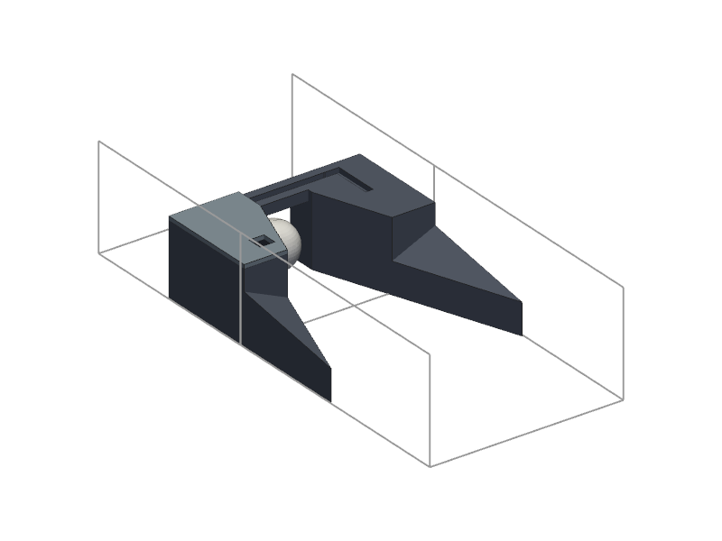

| | |
|---|---|
| 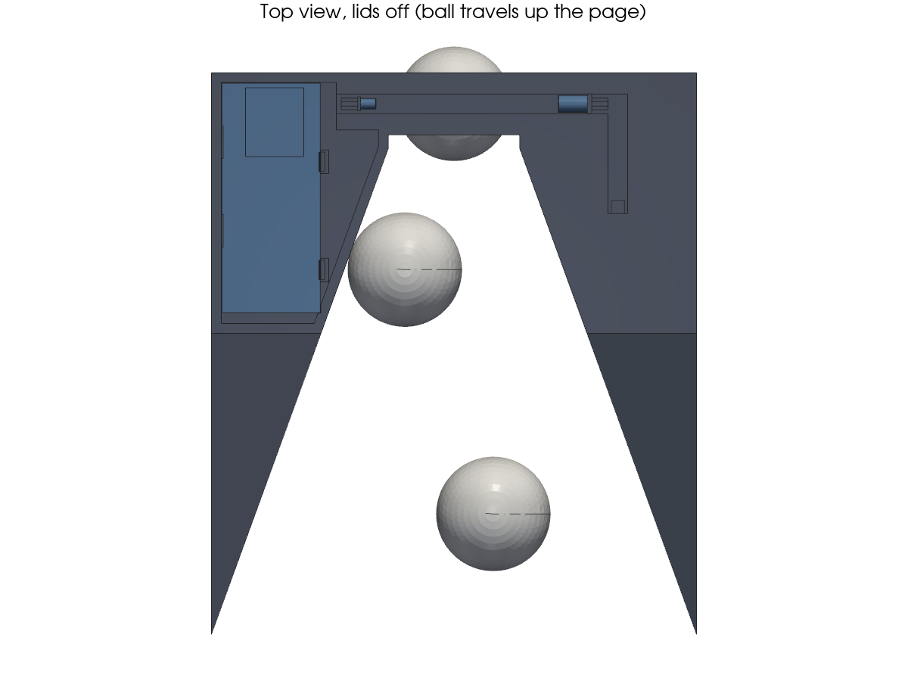 | 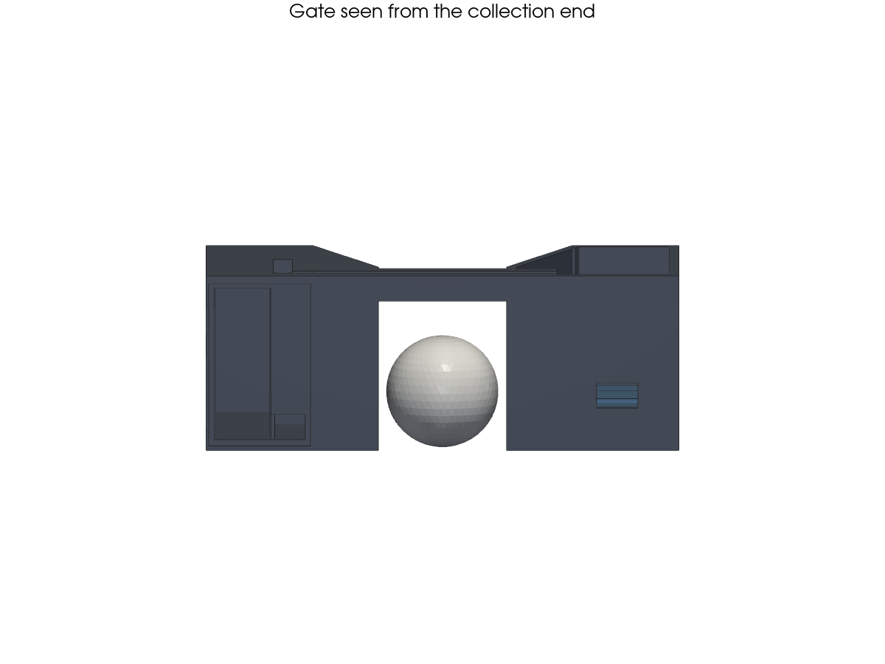 |
| 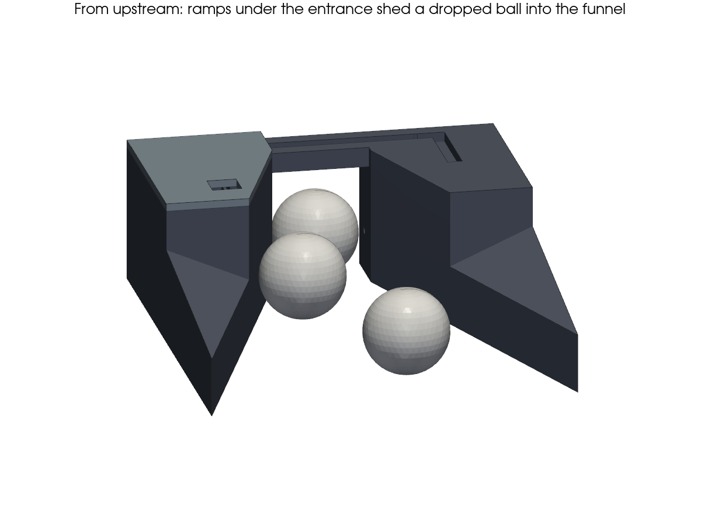 |  |
| 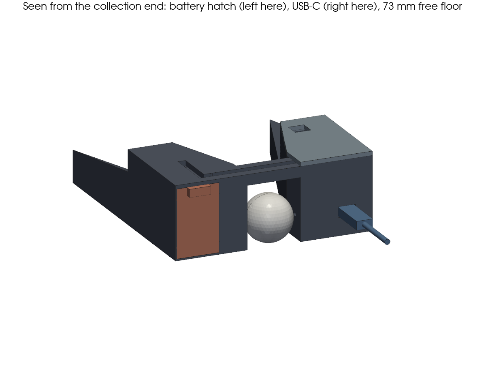 | 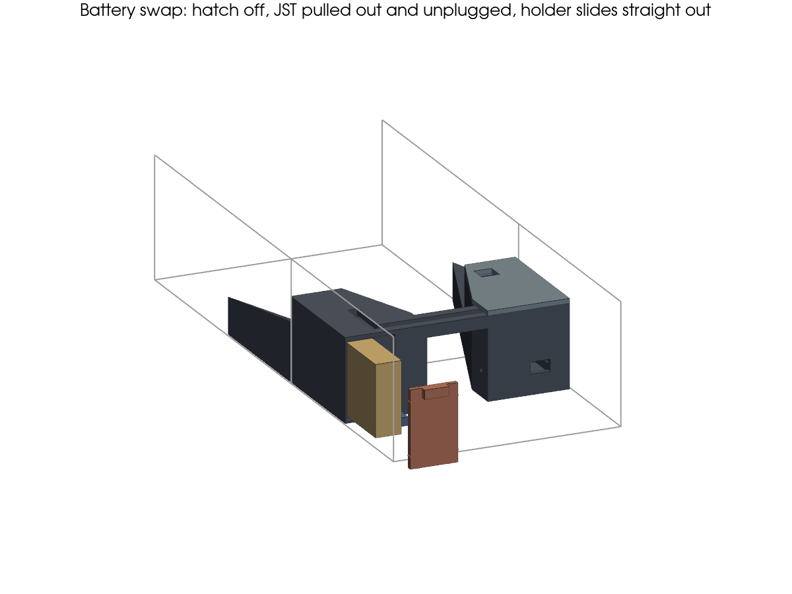 |

The model is `insert.py` (build123d). Every drawer and part dimension is a named parameter at the top.

```sh
uv run python insert.py           # self-check, then export out/*.stl, out/*.3mf and render out/*.png
uv run python insert.py --check   # self-check only
```

**Real drawer (v4 sled, 2026-10-15):** the tunnel and the sled concept are in [`drawer-v4-concept.md`](drawer-v4-concept.md).
A roll-test print of the sled's ball path, which doubles as a tunnel gauge: [`ROLL-TEST.md`](ROLL-TEST.md) (`roll_test.py`).
**The real sled (2026-10-17):** [`SLED-ASSEMBLY.md`](SLED-ASSEMBLY.md) (`sled.py`, which imports `roll_test.py`).

**Print, assemble and install:** [`print-and-install.md`](print-and-install.md). That file has the BOM
items and the step-by-step guide for `hardware/ASSEMBLY.md`.

## Current state (v3, 2026-10-15: service from the end face)

| | |
|---|---|
| Insert | 148 × 171 × 58 mm. Body is one piece, plus a left lid and an end-face battery hatch |
| V-walls | 20°, 148 mm long. The stall margin at the worst-case 1.6° floor is **1.50**, against 1.86 for the bare floor |
| Placement | Downstream end 73 mm from the end wall: the battery holder (68 mm) slides fully out onto that floor, and USB-C cables fit there. The V-wall tips sit 106 mm from the upstream end |
| Under the entrance | The first 92 mm of the insert is ramped: entrance end at 200 mm ± 10, ramps at 25°, V-wall 24 mm high there. The ramps stop 5 mm past the furthest a falling ball's centre can reach (edge + 10 − radius) |
| Gate | 40 mm wide, 47 mm clear height. The roof over it is the 22 mm strap band |
| Beam | z = 17, coaxial. Receiver TEFT4300 sits 4 mm behind its Ø3 aperture, emitter TSAL6200 12 mm behind its own; 40 + 4 + 12 = 56 mm path. Each is held by its flange between two shoulders |
| Electronics | 70×30 perfboard 6 mm above the floor, touching plastic only on its joint-free zones: an end rail under the USB end, edge ledges and 2 pin bosses. It's held by 2 wall lips and 2 snap clips with crush bumps (no screws). The clips are 1.6 % strain; one is a release-by-lift detent. USB-C exits the downstream face; the calibration sockets are reached through a hole in the lid |
| Battery | DFRobot FIT0610 stood on its long edge in a tunnel along the right outer wall, open at the downstream face and closed by a flush hatch held by crush ribs. To swap cells: hatch off, pull the JST out of its pocket beside the tunnel and unplug, slide the holder out by its ribbon. The board-side lead keeps a 40 mm loop in the pocket and is hot-glued where it enters the channel, so the pull never reaches the board |
| PETG | ≈ 196 g per insert (estimate) |

The length is set by the funnel, not the battery. Each step shallower costs about 10 mm and gains stall
margin; the ramps let the funnel extend under the entrance.

## Parameters to measure

Set them at the top of `insert.py` and re-run. The self-check fails loudly if a part stops fitting.

| Parameter | Now | Status |
|---|---|---|
| `DRAWER_W`, `DRAWER_H` | 150, 80 | user-confirmed |
| `DRAWER_L` | 350 | user, approx. |
| `ENTRANCE_END_Y` / `ENTRANCE_ERR` | 200 / 10 | user, approx.: drawer's upstream end to the downstream edge of the entrance opening |
| `DRAWER_SLOPE_DEG` | 1.6 | user: 10–20 mm drop over 350 mm, so 1.6–3.3°; worst case used |
| `BALL_D` | 35 | user-measured |
| `BAT`, `USB_Y`, `USB_Z` | FIT0610 datasheet / electronics' estimate | verify on arrival (electronics/dimensions.md) |

## Design notes

- **The ball only ever rolls on the drawer floor.** The insert has no floor in the ball path, so there are
  no lips or steps. The body prints upright, so layer lines on the V-walls run along the direction of travel.
- **Stall check** (`self_check()`): gravity along a V-wall against wall friction (μ 0.4) plus rolling
  resistance (0.015). The model is crude, so roll-test a real ball before trusting it. Margin at 1.6° by
  V-wall angle: 20° 1.50, 25° 1.37, 30° 1.24, 35° 1.10, 40° 0.95 (stalls).
- **Ramps** (25°) cover the stretch of insert that sits under the entrance opening: the upstream
  `Y_R` mm, which the check reports. A ball landing on a ramp rolls inward over the 24 mm V-wall edge into
  the funnel. That edge is taller than the ball's 17.5 mm radius, so a ball rolling on the floor is still
  turned by the wall.
- **V-wall tips** sit 1 mm from the drawer walls. A ball rolling along a drawer wall meets the V-wall face
  first, so it can't catch on the tip (checked).
- **End-face service (user, 2026-10-15).** Batteries and USB-C are reached from the collection end, never
  the top. The holder's 68 mm length can only lie along y: across the drawer it's wider than a side region,
  and stood on end it's taller than the drawer allows. So it slides out along y and needs 68 mm of free floor.
  That moved the insert 35 mm upstream, which put more of it under the entrance. The ramps now stop at the
  furthest a falling ball's centre can reach, not at the opening's edge: a ball can only touch the flat top
  beyond with its side, and it rolls back off.
- **Nothing on the face catches a ball.** The hatch is flush and sits on a 1.5 mm ledge, so a ball bouncing
  back off the end wall can only push it in. Its pull lip starts 46 mm up, above any ball. A ball dips
  1.2 mm into the 13 mm USB opening.
- **Keystone 2487** is 18.5 × 68.5 × 48: set `BAT` to it and re-run (the tunnel and ribs follow).

## Open items

- Real drawer measurements; the entrance position and slope are both approximate.
- Verify the FIT0610 outline and lead exit, and the USB-C port position, on arrival.
- The collection end: the self-check assumes the floor in front of the insert is open above it (that's
  where balls are taken out), so the holder can be lifted once it's clear of the face. Confirm with the
  real drawer.
- Ball test in the real drawer (last step of the install guide).

## Scoreboard enclosure (v5, INTERFACES §8)

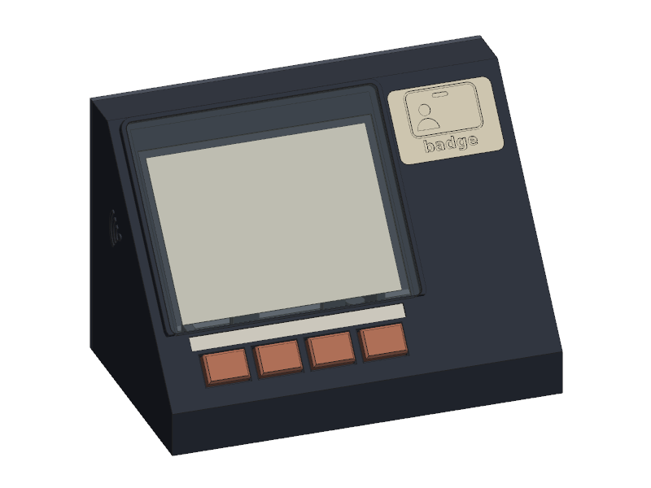 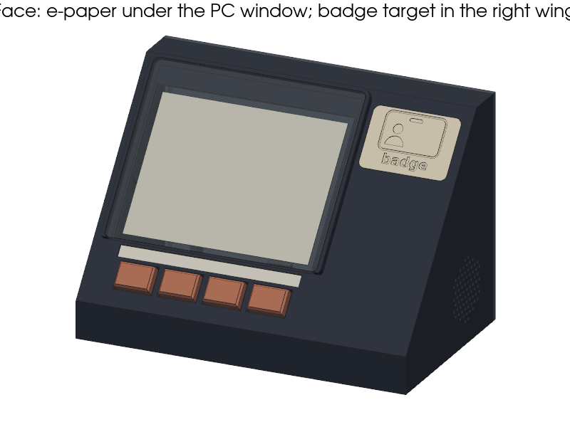

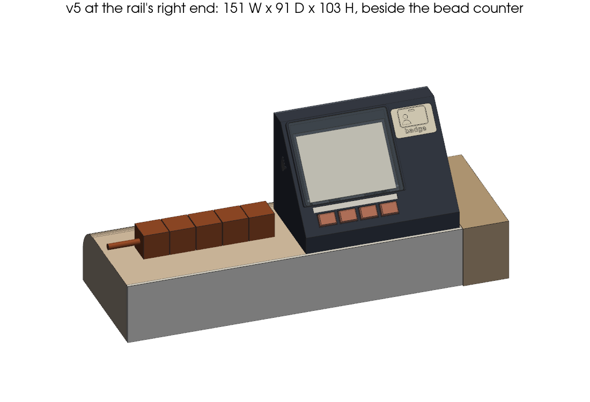

`scoreboard.py` (`uv run python scoreboard.py`; `--check` for the self-check only) builds the scoreboard for the **right
end of the end shelf**, beside the bead counter (user, shelf-11..13). It faces along the table, square to the rail, and is
held down with tape only. Parts come from `electronics/dimensions.md` and `electronics/premium-sound.md`, the physical UX
from `ux/PHYSICAL-UX.md` ('v5: fit the end shelf'). The fit to the shelf: `shelf_fit.py` → `out/shelf_fit.png`.

- **Size:** footprint and height in INTERFACES §0. It is ≈ 17 mm from the bead counter's end cube and 2 mm from the side
  panel, and fits the shelf's 95 mm flat with ≥ 3 to spare (`SHELF_FLAT`, asserted).
  - 3 strips of 19 mm foam tape run across the full width, all on the flat underside.
  - Centre of mass: ~61 mm back, 41 up, i.e. over the middle of the flat (asserted).
- **Face, 50° (ux):** a vertical **front wall** (17 mm) lifts the face, so the key row sits only 14 mm up the slope (key
  centre 28 mm above the shelf, ux ≥ 20) while the MX switches still clear the floor. That shortens the face to 112 mm.
- **Screen section (inner side, next to the counter):** as in v4, i.e. the e-paper, the LED bar and the 4 MX keys in one row
  under it, at 20.32 mm pitch, centred on the active area; key top → active area 12.9 mm (ux ≤ 14).
- **Protective window (user/ux):**
  - **Material:** 3 mm low-haze anti-glare hard-coated polycarbonate, satin side out (glossy as the fallback), cut by hand.
    The cut size is printed by the self-check (97.0 × 80.6, R2.5).
  - **Mounting:** it sits ON the face inside a flush 3 mm rim on 3 sides (open at the bottom, so it doesn't cover the LED
    bar), on thin double-sided tape.
  - **No load path to the panel:** it bears only outside the panel glass; a 0.3 relief keeps it off the skin over the glass.
  - **Gap:** 0.9 mm of air to the panel (ux 0.5–1.0).
  - **Full-area backing:** the retainer is a backing plate with 0.8 mm of foam behind the whole panel. If a hard shot pushes
    the window onto the panel, the panel is pressed flat (compression, no bending; lead).
  - **Symmetric frame (user):** the window is sized to the panel glass, whose inactive border is 10.3 mm on the FPC edge
    (up) and 3.1 mm elsewhere. Clear, it would frame the image off-centre. So its back is masked matte black in the case's
    colour, leaving a clear aperture of the **active area + 2.8 mm on every side**; the skin's view opening matches.
  - **Parallax:** the mask's edge sits ~1.2 mm above the pixels, which hides nothing at 65° sideways or 40° vertically
    (asserted).
- **Badge target (ux v5): on the face, in the right wing**, upper half: the translucent PETG insert sits flush in a
  window, with ux's ID-badge mark.
  - **Reader:** the RC522 lies behind it, parallel to the face, flat back toward it, **loop end up** (as far from the
    speaker as the face allows).
  - **LED5:** the insert's tongue runs down under a 1 mm skin to LED5, which sits **below** the module, never in view,
    with its wires leading sideways (electronics).
  - **Loop distances (asserted, electronics' v5 keep-outs):** cells 21 (≥ 20), speaker 26 (≥ 25), LED5 24 (≥ 10),
    amp 58 (≥ 30), phone tag 102 (≥ 45; 60 target), DESPI 54, XIAO 75. The e-paper is beside the loop, not in front of it.
- **Phone NFC tag (lead/ux): inside the left (inner) wall**, upper back, 62 mm above the shelf, so a phone held flat
  on the wall clears the 25 mm beads; with the glyph outside, and nothing else on that wall.
- **Sound, one grille on the right (outer) wall, back-low:** 73 × Ø2 holes, 32 % open over the cone.
  - **Option A, the speaker:** in its printed back cup (24 cm³), taped into a 1.5 mm lip with a double-sided foam ring.
  - **Option B, the buzzer:** in a printed disc taped into the same lip.
  - The amp + 470 µF lie on the wing's floor (`AMP`, measure on arrival).
- **Inside:** the 3×AA holder stands on a drop-in shelf over the main board, against the back cover. The PCA9685
  stands on its long edge in 2 floor slots between the key stack and the board.
- **USB-C (lead/electronics):** a panel-mount C-C extension. Its female end is clipped into the **back cover**; its male
  end goes 25 mm straight into the XIAO, whose port faces the left wall. The cable runs along the left wall and in front of
  the holder, away from the reader.
- **Back cover:** friction lip with crush ribs, no magnets. Take it off for the battery swap.
- **LED bar:** use 2 mm opal **polycarbonate**, not acrylic (lead: acrylic can crack on a hit). Keys and the PETG insert
  are fine.

**Measure on arrival:**
- The FPC position on the glass (`FPC_ROOT`, `FPC_TAIL`).
- Where the active area sits on the glass: `ACTIVE_DX` across, `ACTIVE_BOTTOM` up from the glass's bottom edge. The
  window's mask follows them (asserted: it never shows > 0.7 past the glass's edge).
- The speaker (`SPK`) and the amp (`AMP`, `CAP470`).
- The USB extension (`USB_EXT`, `USB_PLUG`).
- One of the user's MX switches against `MX_*`.

**Mirrored build (left end):** deferred (lead) until a left-end table exists. It needs its own internal layout pass,
because the main board can't be mirrored.

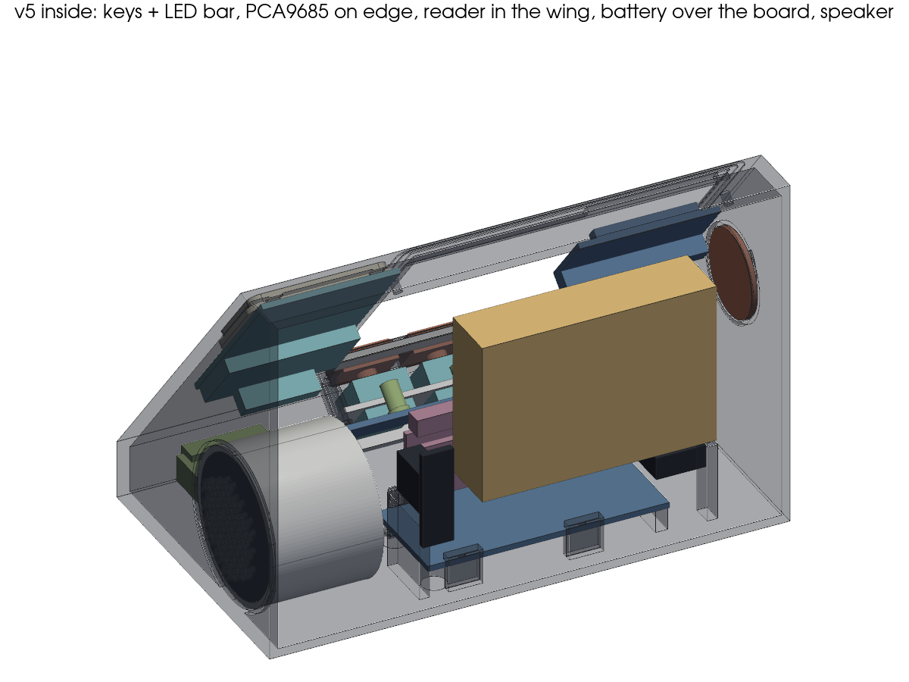 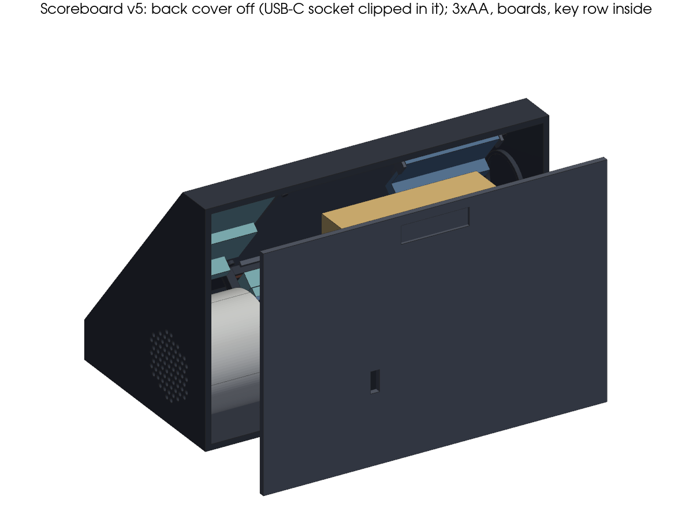

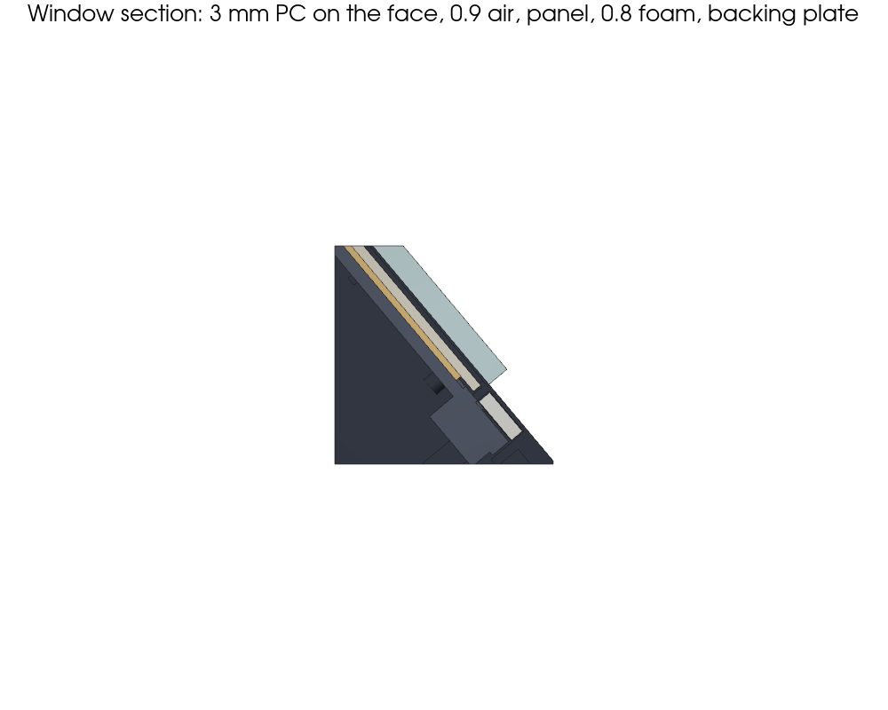 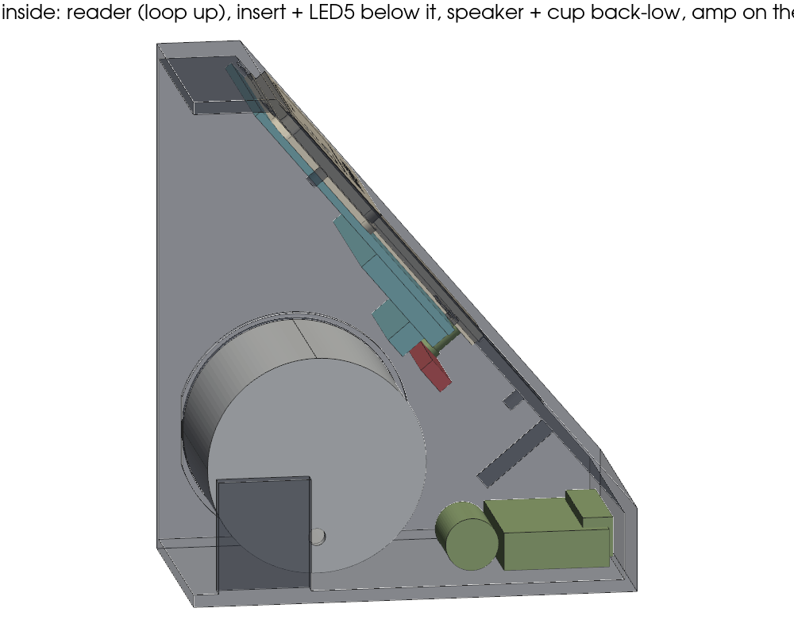 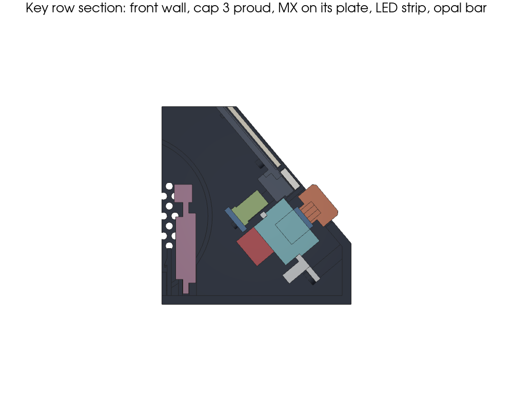
