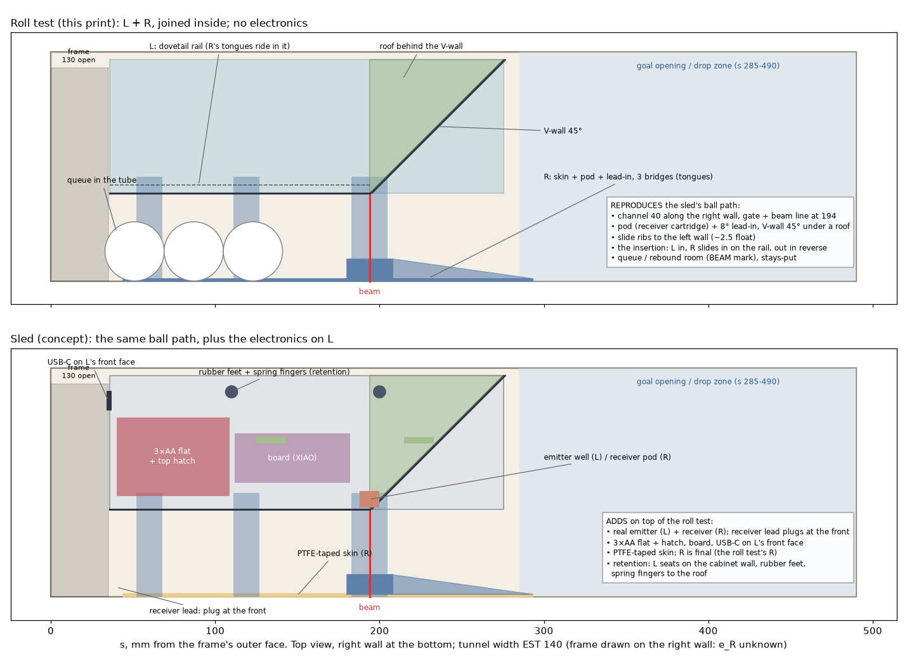
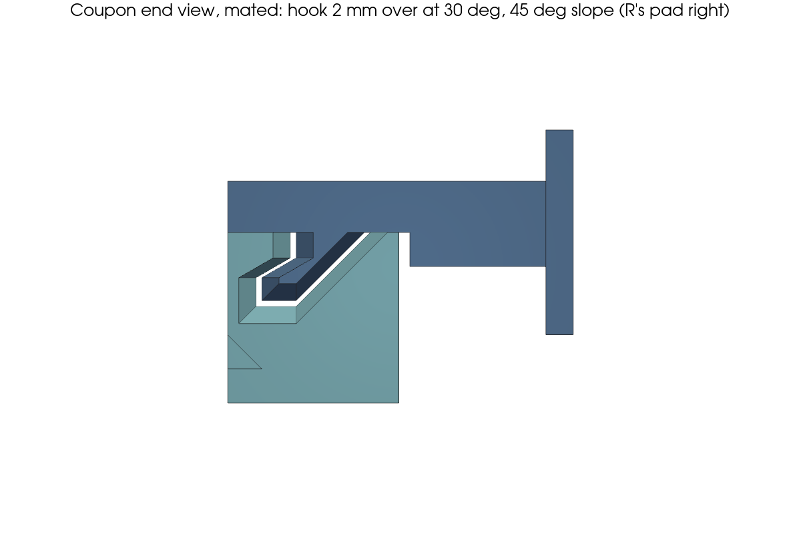
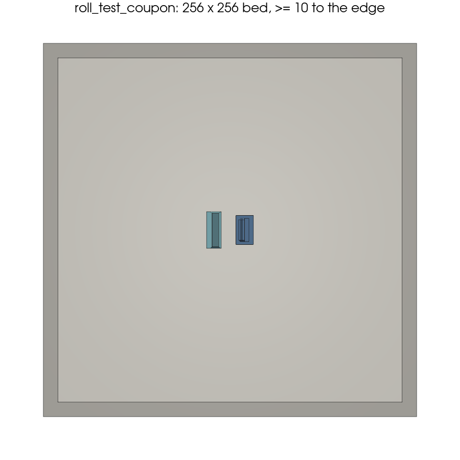
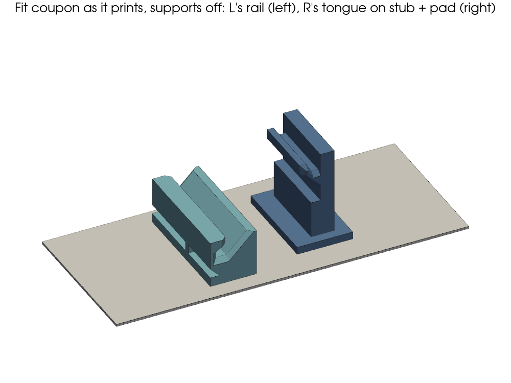
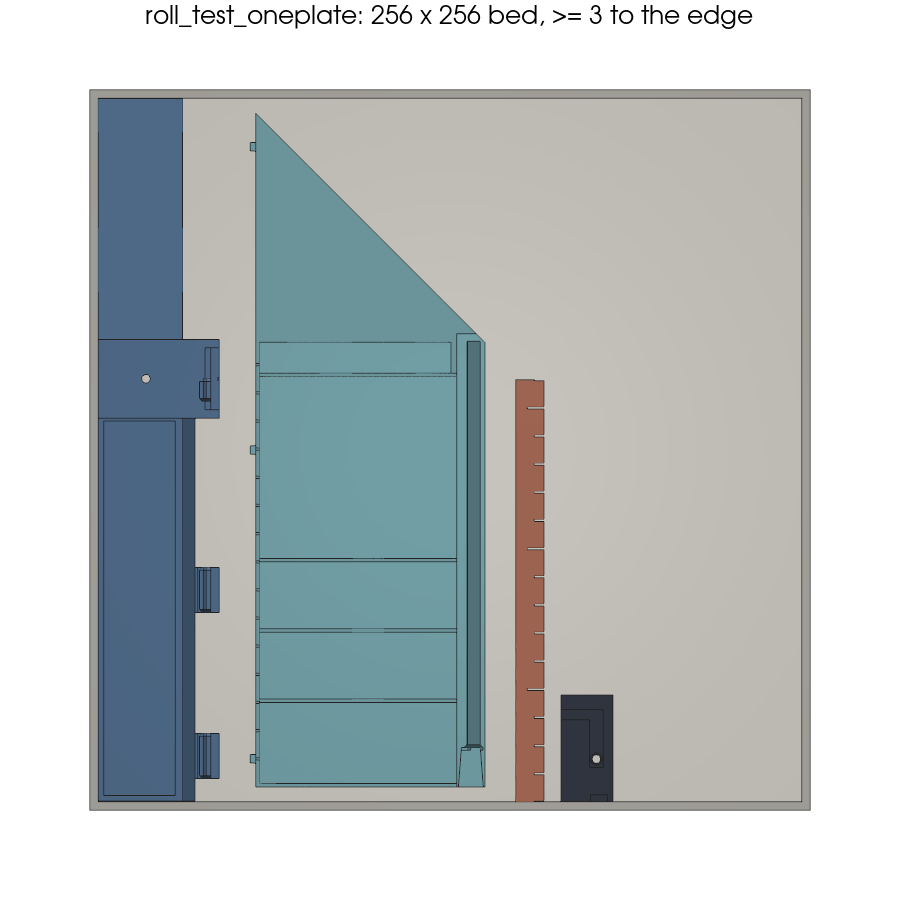
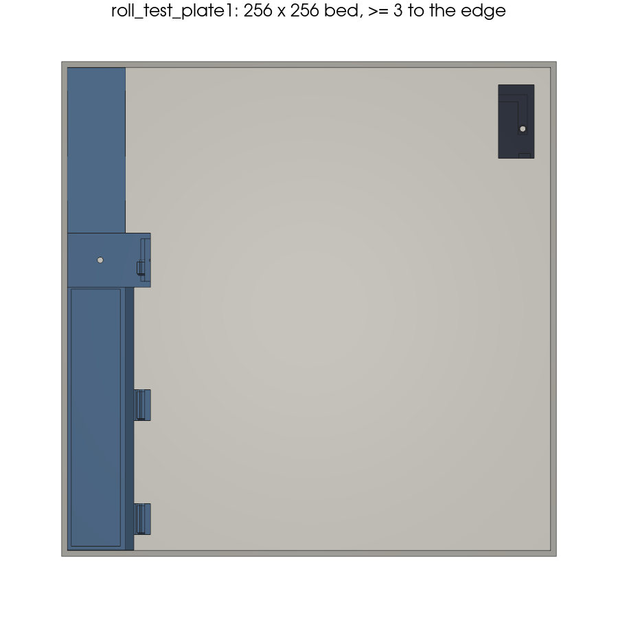
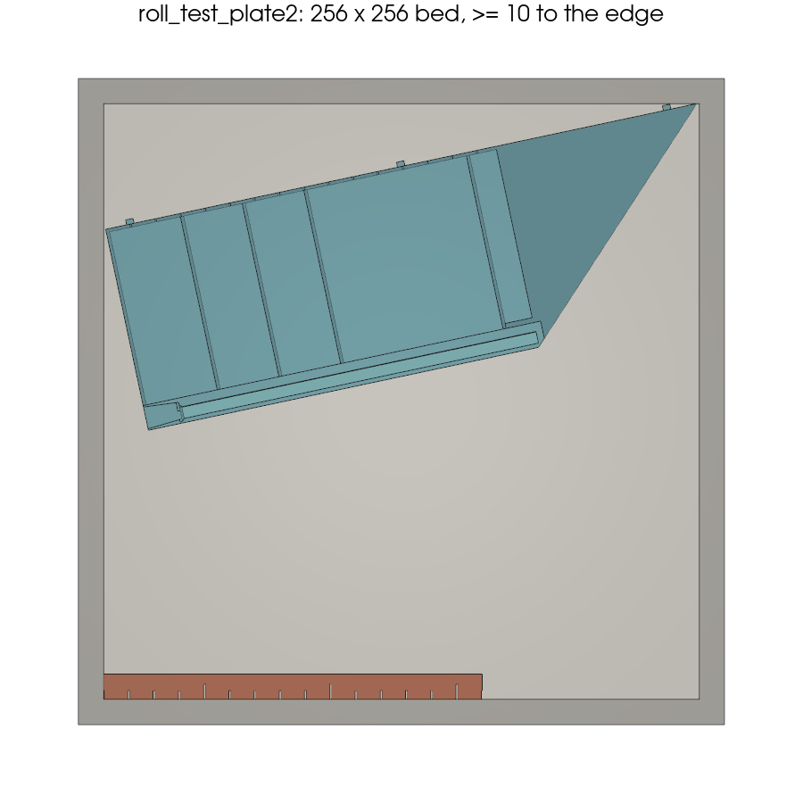
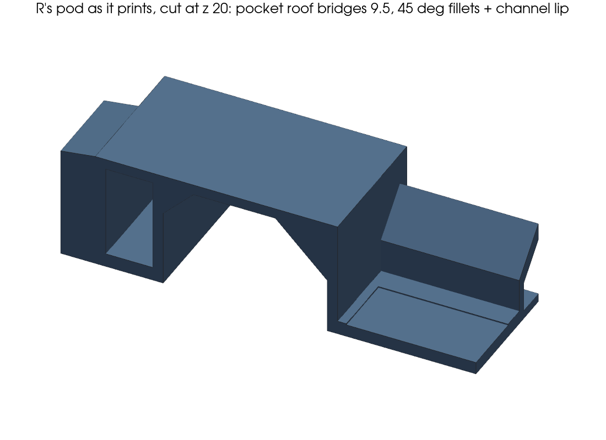
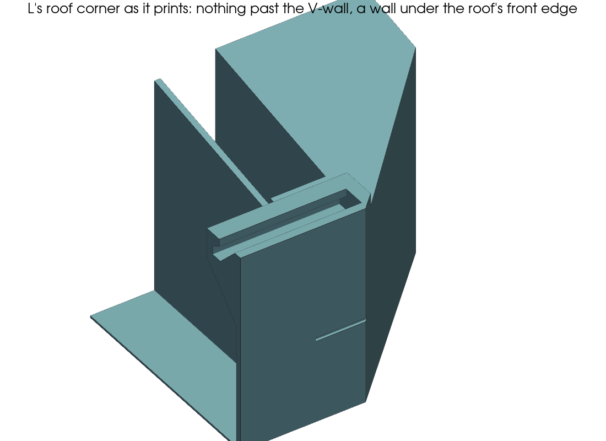
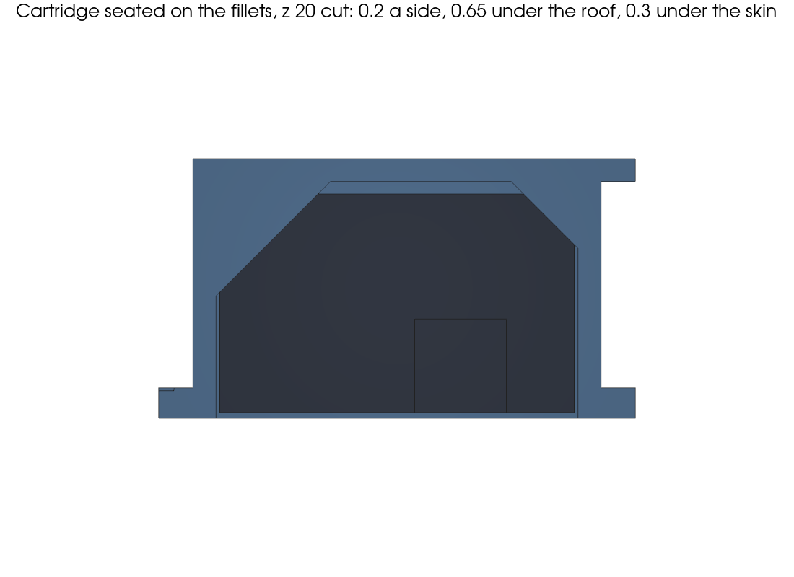

# Goal-counter sled: roll test

A quick print of the sled's **ball path only**: no electronics, no hatch. It checks on the real table that every
ball rolls through the beam and never stalls. It also works as a gauge for the tunnel's size. The design is in
[`drawer-v4-concept.md`](drawer-v4-concept.md), the model in `roll_test.py`.

The tunnel is **wider than the black frame's opening** (~130 × 55), so the piece comes in as **two units that each
fit through the opening and join inside**:
- **L**, the left unit (one print + a **lid**): the channel's left wall with a **dovetail rail** on top, and the diagonal
  V-wall under a sloped roof. The lid closes the box in front of the roof, in the same plane, so no ball can roll onto
  L's top. Three slide ribs on its left face take up the tunnel's spare width.
- **R**, the right unit: the right skin, the pod and its slope with the **receiver cartridge**, and **three bridges**
  on top whose **dovetail tongues ride in L's rail**.

**Version 2 (fit 1, 2026-10-16).** These changes come from the first fit:
- L is 80 mm shorter and ends at s 275, before the block's end. The V-wall is now **45°** (was 35°), so the **beam
  moved from s 240 to s 194**. Waiting balls rest against the frame's bottom bar (s ≈ 33), and four 36 mm balls (or
  five 31 mm balls) still queue clear of the beam.
- No wiper. The ribs leave ~2.5 mm of float, where the first fit had ~4.5.
- The V-wall is ≥ 37 high everywhere, under a roof that slopes toward the channel, so a ball can't get on top. L is **52** high: as tall as passes the ~55 frame opening (user).
- The rail is captive (dovetail), so R can't lift out of it.
- The bridges are 16 wide and 5 deep over the channel, ~7× stiffer than before.
- The receiver goes in a cartridge that slides in **from the back** (R's skin face). The tunnel's right wall then holds it in.
- L has a lid over its box (user's markup), printed later: the roll test runs without it.

Report: [`reports/2026-10-16-roll-test-v2.md`](reports/2026-10-16-roll-test-v2.md).

**Left and right always mean as seen from the opening, looking in.**

## Print

**R is a keeper:** it's the final sled part, with the receiver cartridge, the lead route and the PTFE recess. Only L
is a test unit; it will be redone with the electronics later. **Reprint both** (v2): the old R's pegs don't fit
the new rail, and its pod has no cartridge pocket.

 

**Print the fit coupon first: `out/roll_test_coupon.3mf`** (~8 min, ~3.7 cm³, EST, plus the printer's warm-up). It's
25 mm of L's rail (25 × 10 × 10) and R's middle tongue on an 8 mm stub of its bridge and a small pad (20 × 12 × 20),
each in its real print orientation, so the dovetail prints the same layers as on the big parts. A 5 mm brim is fine.
Coupon 3: the tongue hooks on one side only, 2 mm under L's lip, with the hook face 30° from horizontal. The other side
(the one facing down as R prints) is a 45° slope, so R prints without supports. L's lip overhangs 60°, which is Bambu's
default limit for no supports. Coupon 2's 45° hook ran parallel to the slope, so R slid out along both. 
Slide the tongue into the coupon's rail along its length. It should slide by hand, with a little play, and must not lift out.
- **Too tight:** scrape or sand the tongue's flanks (on R), not the rail.
- **Too loose** (it rattles a lot or lifts out): a layer of tape on the tongue's flanks.
- If it needs a lot of either, tell mechanical before printing the big plates. The clearance is 0.35 mm per side.

 

**Slicer, every plate (coupon included):** Quality → Seam position **"Back"**. The parts are turned so that "Back" puts
the seam off the groove, the tongue and the lips (the model checks this). Don't rotate or auto-arrange them; if you do,
paint the seam off the rail and tongues instead. Every tongue and rail section has a 1 mm lead-in at its ends. Before
fitting, **scrape any seam bump in the groove** and on the tongues with a knife. Coupon 3's tight end was a seam bump
("Aligned" seam).

**`out/roll_test_oneplate.3mf`: everything on one 256 × 256 plate** (Bambu A1/P1S/X1C), laid out. R and L lie
straight along the bed's front-to-back axis, side by side, ≥ 3 mm from the edge and ≥ 6 mm apart, with the wedge and the
cartridge beside them. Load it as it is (don't let the slicer auto-arrange), with supports **off**. **R: no brim.** L needs no brim either (its floor
skin makes a full first layer), but there's room for a **5 mm** outer brim on L only, if it lifts.

**The alternative is two plates.** Plate 1 has R front to back, ≥ 3 mm from the edge (no brim), so the seam stays off
its tongues. Plate 2 has L at an angle, ≥ 10 mm from the edge, so an 8 mm brim fits.

 

- **`out/roll_test_plate1.3mf`: R and the receiver cartridge.** R lies on its skin's outer face, so every wall stands
  upright, the bridges become vertical walls, and the Ø3 aperture prints as a clean round hole. Supports **off**:
  the cartridge pocket's roof (the pod's face wall) bridges 9.5 mm between two 45° fillets, the lead channel's outer
  lip leans out at 45°, and the skin runs up behind the pod. The cartridge lies on its front face, with its front
  corners cut to match the fillets; print it in **black** (light shield).
  
  - PLA is fine for the test. For the final build, reprint R in PETG with the same file.
- **`out/roll_test_plate2.3mf`: L and the wedge gauge.** L stands upright as oriented. Its rail groove needs no
  supports: the hook lip overhangs 60°, and everything else is ≤ 45° or a bridge. The roof spans ≤ 16 mm between
  its ribs and the wall under its front edge. Nothing of L sticks out past the V-wall.
  
- **`out/roll_test_lid.3mf`: L's lid, for later.** The roll test runs **without** it (user). A ball may land on L's
  open top; that's expected and not a fail.

Use 0.2–0.28 mm layers and 3 walls. That's about 110 g and **~3 h** for the two plates (EST).

**If it doesn't stick:**
- Wash the plate with dish soap and water and dry it; don't touch it after.
- Bed: PLA 60–65 °C, PETG 70–80 °C.
- **Outer brim** on L only (Bambu Studio: per object, Others → Brim type 'Outer brim only'): ≤ 5 mm on the one plate, 5–8 on plate 2. None on R (it's 3 mm from the edge). Glue stick if needed.
- Or print the plates separately.
- L has a 0.4 mm floor skin under its frame, so its first layer is one sheet, not just thin rails.

**PLA is fine for this test.** PLA prints a little tighter and stiffer than PETG:
- If R's tongues bind in L's rail, sand the tongues (the coupon tells you first). The clearance is 0.35 per side.
- The cartridge is a slip fit: 0.2 mm clearance per side, no crush ribs (v2's ribs were far too tight). It stops on the
  pocket's two 45° fillets, 0.65 mm short of the bridged roof (v2's roof sagged and stopped it), with its back 0.3 mm
  under the skin's face. If it still binds, scrape any strings off the roof around the Ø3 hole. It can't fall out in
  the tunnel, because the right wall holds it; on the bench, a strip of tape over the window holds it.
  

Keep the parts out of a hot car: PLA softens at ~55 °C.

Each unit is ≤ 84 wide; L is 52 and R 43 high, so both pass the ~130 × 55 opening (3 mm to spare for L).

## The receiver cartridge (R's final feature; not needed for rolling balls)

 

Everything happens **on the bench, with the cartridge in your hand**. Lead details:
[`electronics/receiver-cartridge-leads-2026-10-16.md`](../electronics/receiver-cartridge-leads-2026-10-16.md).
1. Mark the TEFT4300's collector (the shorter leg, on the flange-flat side) **before** you trim anything.
2. Push the TEFT4300 into the cartridge's bore from the back (the open side), flange first into its seat. Its tip then
   sits 4 mm behind the pod's Ø3 aperture. Put a dot of hot glue on the flange.
3. Bend both legs 90° **up** in the groove, ≥ 2 mm behind the flange (hold the legs with pliers between the flange and
   the bend). Then solder the jumper wires and shrink the joints (electronics' guide).
4. Lay the two wires up the groove and into the side groove that runs out through the cartridge's narrow side, stacked
   one above the other. Hot-glue the jackets in the grooves above the joints, then scrape the glue flush with the back.
5. Fit the 2-pin housing (flag it **SENSOR**). The whole route is open, so nothing has to be threaded.
6. **Slide the cartridge into R's pod from the back**, through the window in the skin, with its open (wired) side
   facing out, until it stops against the pod's face wall. The wires pass through the notch in the pod's end wall,
   which is open at the back. It's a slip fit; in the tunnel, the right wall keeps it in.
7. Press the pair down into the U-channel on top of the skin. Under each bridge, slide it in from the gate side.
   Tape or glue it every ~50 mm. The plug ends at R's front end, for J_PT.

To take the cartridge out, lever it from the back with a small flat screwdriver in the slot at its lower edge.

**PTFE skin:** a 0.15 mm recess on the skin's inner face takes 25 mm PTFE tape flush, so its edge can't catch a ball.
Tape the pod's face and the 8° lead-in too, with a Ø4 hole punched in the tape over the aperture.

## Put it in, and take it out

1. **Take the balls out.**
2. **L goes in first:** V-wall end first, upright, with the scale nicks on the **left**.
   - Slide it in over the frame's bottom bar; the wooden floor is ~1 cm lower, so let it down gently onto the floor.
   - Slide it in until its front face is about 36 mm inside the frame's outer face, just past the black frame tube.
     Its tip then sits ~1 cm short of the block's end (~285).
   - Leave room on its right for R (about 6 cm).
3. **R goes in second, along the right wall:** pod end first, bridges on top pointing left.
   - The innermost bridge (marked **BEAM**) arrives at L's front first. Drop its tongue into the open funnel at the
     front of L's rail (14 mm long); you can see it there. Then slide R in. Its tongue can't lift out of the dovetail.
   - The middle bridge's tongue, then the front one's, enter the mouth the same way as they pass L's front.
   - R stops when the BEAM tongue reaches the end of the rail.
4. Push the pair right until R's skin touches the right wall. Then L's ribs have ~2.5 mm to the left wall (EST).
5. **Measure d**, the frame's outer face to L's front face, in mm. The nicks in L's left wall top are every 10 mm from
   its front face (deep ones every 50; the lid, later, has the numbers), so **add d to every scale reading** to get mm from the frame.

If a unit stops short (something near the goal opening, ~28 cm in, catches it), note d and where it touches, and
send a photo.

**Out:** pull **R** out first. Its tongues slide out of the open front of the rail. Then pull L out.

## Measure (wedge gauge: thickness = the number at the line, 1–16 mm; a ruler for larger gaps)

| What | How | Gives |
|---|---|---|
| Tunnel width | The gap between L's ribs and the left wall (R against the right wall), near the front and the tip | 137 + gap |
| How the frame sits | A ruler at the mouth, from the right wall to the opening's right edge, then from the opening's left edge to the left wall | e_R, e_L |
| Tunnel height | Wedge between L's left wall top (52) and the tunnel roof | 52 + reading |
| Frame step | Wedge (or a ruler) where the tunnel floor meets the frame's lower lip: up or down, and how much | step in mm |
| Where balls land | Drop a ball through the goal mouth: which scale mark does it land beside? | entrance position |
| Floor slope | Phone level app on the floor, along the tunnel, then across it | degrees, both ways |

## Tests

Do each test **10 times with a 36 mm ball and 10 times with a 31 mm ball**. Watch through the frame opening with a
phone torch, or film it; the goal mouth works too.

| # | Test | PASS | FAIL |
|---|---|---|---|
| 1 | **Slowest roll:** let the ball go *without any push* from the goal mouth, or set it on the floor under the entrance. **Watch the 45° V-wall:** start some balls on the left so they reach the wall slowly | It rolls along the V-wall, past the BEAM mark and on to the frame every time | It stops anywhere before or at the BEAM mark: **resting against the 45° V-wall**, at the pod's slope on the right, or on the open floor |
| 2 | **Drop on the left:** drop balls through the goal mouth on the left, so they land near L's tip and the V-wall | Each one ends up in the channel and passes BEAM | One gets on top of L, stays on the roof or behind the V-wall, or stops before BEAM |
| 3 | **Queue:** with 3 balls waiting at the frame, roll in a 4th | All 4 wait downstream with the last ball's back ≥ 10 mm short of BEAM. Note how many fit | A waiting ball touches the BEAM line |
| 4 | **Rebound:** 3 waiting; drop a 4th through the goal as in a real goal (a soft one and a **hard shot**), and some straight onto the **45° V-wall** | It bounces back less than to BEAM, and the V-wall never kicks a ball back up the tunnel. Note the furthest scale reading its front edge reaches | Any ball goes back over the BEAM line, or bounces off the 45° wall back into it |
| 5 | **Creep:** after each test, watch for 5 s | Nothing moves back toward BEAM | A ball rolls back toward BEAM |
| 6 | **Sled stays put:** after all the tests, re-measure d | Within 2 mm | It moved more |
| 7 | **Left wall:** roll and drop balls along the LEFT wall, upstream of L's tip | Each one is turned by the V-wall into the channel and passes BEAM | One gets between L and the left wall, or stops at L's tip |
| 8 | **Right wall:** roll balls along the RIGHT wall, upstream of R's tip (s ~293) | Each one passes R's lead-in tip into the channel | One catches on R's tip (it may sit ≤ 2.5 off the wall) |

If you have **PTFE (Teflon) tape** (25 mm), stick it into the recess on R's skin, on the pod's slope and on its face (with a
Ø4 hole over the aperture), then repeat test 1. That's the friction the final sled will have.

## Send back

- **Numbers:** d; e_R and e_L; the width (gap) and height readings (front and at BEAM); the frame step; the landing mark; both slopes;
  passes out of 10 per test and ball size; the furthest rebound (scale reading); how many balls fit before BEAM;
  where any ball stopped (scale reading + left/right).
- **Photos:**
  1. The piece in the tunnel, from the opening, with L's tip in view if possible.
  2. The wedge in the left gap, with its number readable.
  3. The wedge on the strap, under the roof.
  4. The frame's lower lip from the side, with a ruler.
  5. Three balls queued, with the BEAM mark in view.
  6. Anything that stopped a ball.
