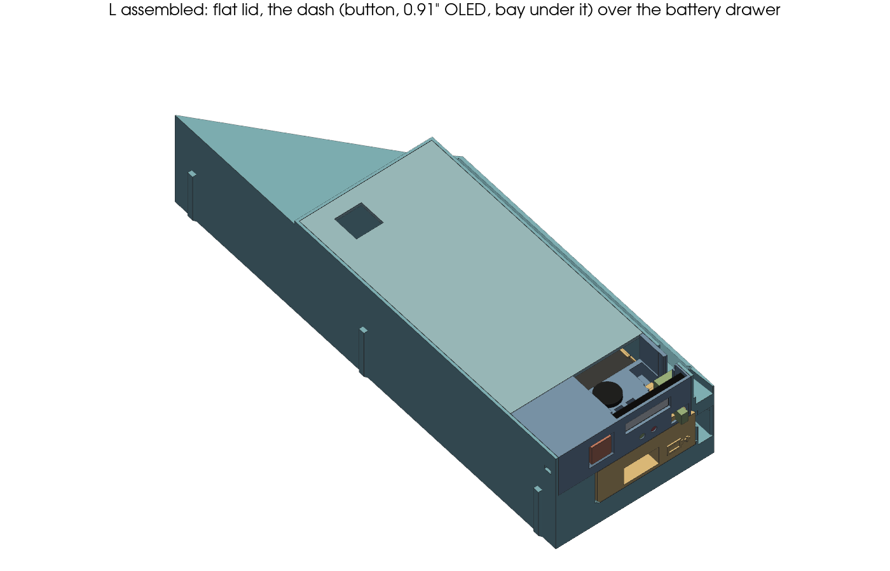
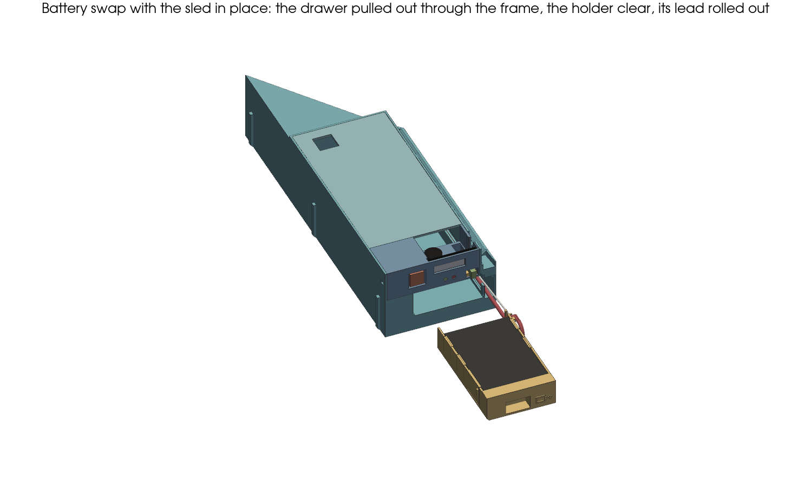
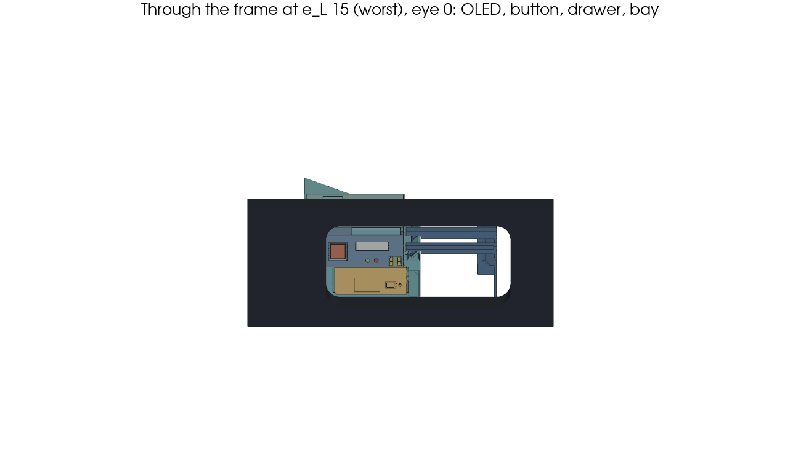
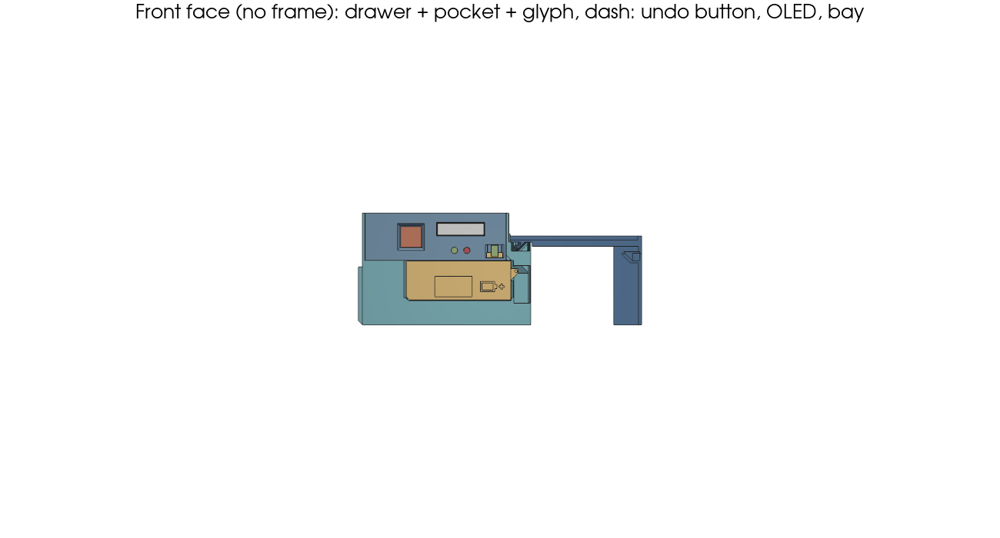
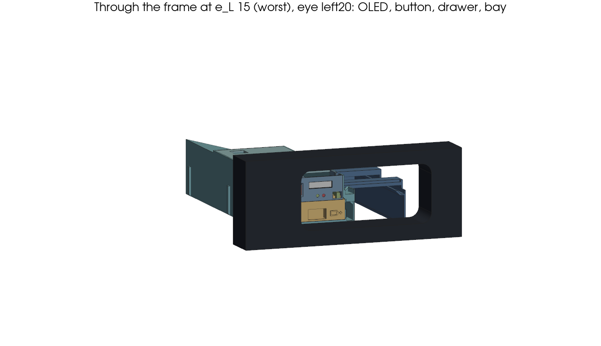
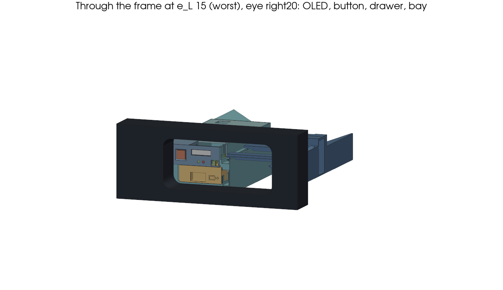
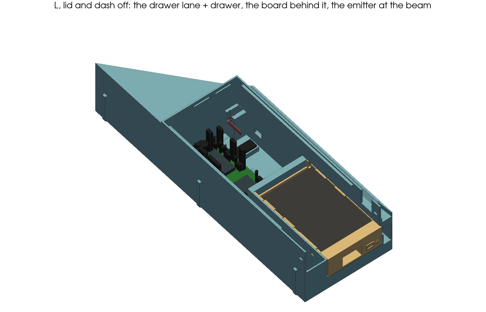
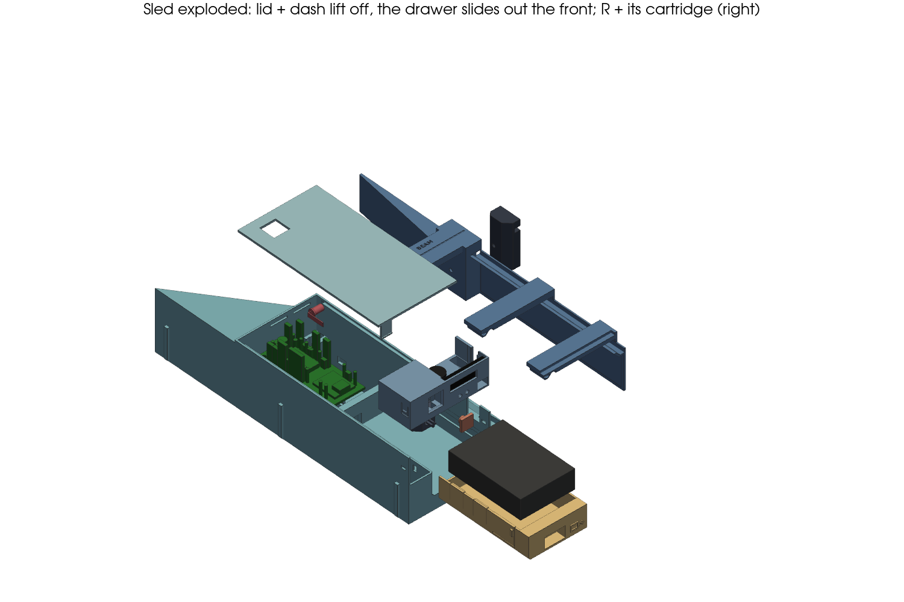
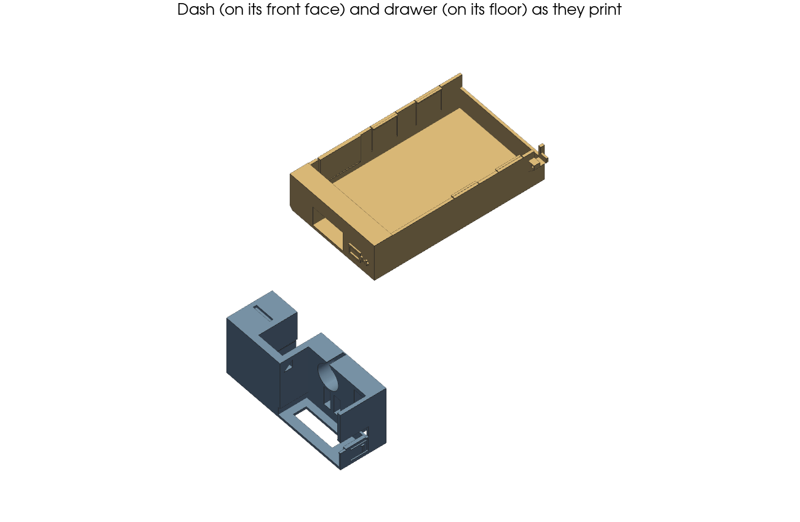

# Goal-counter sled: print, build, install, swap the cells

The goal counter for one goal drawer. It is the roll test v2's ball path ([`ROLL-TEST.md`](ROLL-TEST.md)) with the
electronics inside L. Front, take 2 (DECISIONS 2026-10-17):
- the AA cells sit in a **battery drawer** that slides out through the frame, so the sled stays in;
- a white **0.91" OLED** (128 × 32, upright: it reads best through the frame, `reports/2026-10-18-slim-display-proposal.md`) is on the front.

The model is `sled.py`, which imports `roll_test.py`'s geometry and checks. Agreed in
`reports/2026-10-17-drawer-oled-proposal.md` with electronics, ux and assembly-review. Part placement is in
`../electronics/dimensions.md`; the contacts and wiring are in `../electronics/battery-drawer-electrical-2026-10-17.md`
and electronics' ASSEMBLY.

```sh
uv run python sled.py           # self-check, then out/sled_plate1..4.3mf, out/sled_*.stl, renders out/sled*.png
uv run python sled.py --check   # self-check only
```

Values marked EST aren't measured yet (see the end). The other drawer is the mirror image.

| | |
|---|---|
|  |  |
|  |  |
|  |  |
|  |  |

## 1. What's where (front view, e_L 10–15)

- **L's box has a flat top at 54** (the measured 57 opening less 3) from the front wall to s 199. The sloped roof stays only
  behind the V-wall.
- **Bottom row: the battery drawer.** It holds a FIT0610 3×AA, cover up, in a lane at r 21–72, z 12–31.
  - **Front plate:** flush with L's face, with a finger pocket (18 × 10, 8 deep, a lip to hook) and a ▭+ glyph.
  - **Latch:** a detent arm clicks it home, within 0.2 of its stop.
  - **Key:** a chamfered bottom-left corner, so it goes in only one way.
  - **Battery lead** (lead 2026-10-18; no contacts): the holder stays plugged in by a lead that ends in a JST-PH
    2-pin pair (polarized, friction lock) in a pocket beside the board. The lead rolls in a U in its own channel under the rail, right of the lane, on a ledge above the bar. Its lower strand lies
    still. The upper strand rides with the drawer: from a tab on the drawer's rear corner, through a slit in the
    lane's right wall. The bend rolls at half the drawer's speed. Pushing the drawer in **pulls** the lead, so it can't
    fold into the drawer's path. When the drawer is out, the bend sits just in front of the frame, beside the drawer.
  - **Stop:** a Ø1 nonconductive cord rolls in the same U, beside the lead. It is tied to the ledge and to the tab,
    and it stops the drawer at 125 out while the lead still has slack (R2-S2). The lead never takes the pull.
- **Top row: the dash**, a separate print over the lane, holding from left to right:
  - the **undo key**: an MX Blue switch with a plain printed 10 × 10 cap in a contrasting filament (no label: the button may get another job later; an 18 mm cap wouldn't stay inside the opening at e_L 15);
  - the **OLED**, upright in the top of the row, its active area at r ~36–59 (mid-opening);
  - the **receiver bay**, under the OLED's right end: R's keyed plug.

  The buzzer stands in the block under the OLED, its port up into the open room behind the display (no grille).
- **Behind the lane: the board.** Its USB-C faces the lane's back wall. Reach it **through the empty lane with the
  drawer out**: run the plug along the lane's left wall on its floor, and the funnel guides it.

## 2. Print (PETG, supports off, seam position "Back", no brim)

| Plate | Parts | Notes |
|---|---|---|
| `sled_plate1.3mf` | R (on its skin) + the receiver cartridge (black) | R: the roll test's R + a 3.4 × 2 rebate across its front bridge. The cartridge's tip sits 4.4 behind its aperture (review 2: less daylight): reprint a cartridge printed before |
| `sled_plate2.3mf` | L, upright, turned 12° | Keep the 12°: it keeps the seam off the rail's sliding faces |
| `sled_plate3.3mf` | lid (outer face down) + drawer (on its floor) | |
| `sled_plate4.3mf` | dash (on its front face) + MX key plate (flat) + keycap (face down) | Print the **keycap in a contrasting filament** |



**Black filament must block 940 nm** (review 2, R1.6). Before printing the cartridge, print a 20 × 20 × 1.2 square in
it, hold it over the receiver with the beam on and check that the beam reads **blocked** (electronics' ASSEMBLY beam test).
If it doesn't, use a carbon-black filament.

Every face past 45° is either ≤ 1 across or a bridge anchored at both ends: ≤ 16 on L, ≤ 10 on the rest. `sled.py
--check` asserts this for every part, as it prints.

## 3. Bought parts (`../electronics/bom.md`)

**Battery and its lead:**
- the FIT0610 3×AA holder (its slide switch bridged);
- the battery lead: a 2-wire strip peeled off Adafruit 6181 silicone ribbon (24 AWG, a 2.8 × 1.4 flat pair, bend
  r ≥ 7). It runs ~260 from J_BAT's PH plug to the joint with the holder's own leads (electronics sets the exact cut);
- J_BAT: a JST-PH 2-pin pair (Adafruit 1131, cut in half). Electronics solders the board half's pigtail at holes
  (17,0)/(19,0); the other half goes on the battery lead;
- F1: a 2 A pico fuse in the holder's + lead, heat-shrunk (electronics);
- the drawer's stop cord: ~200 of Ø1 braided polyester or Dyneema (≥ 20 kg, nonconductive);
- 2 small zip ties (≤ 2.5 wide), heat-shrink.

**On the board and its leads:**
- the 70 × 30 board, wired;
- the TSAL6200 with its lead;
- the 3-pin J_PT extension with its header (pin 3 pulled).

**In the dash:**
- the 0.91" white 128 × 32 SSD1306 OLED (Waveshare 14657, 36.0 × 12.5 including its PH2.0 socket), with its lead: 4 ×
  28 AWG (~200) soldered into its 2.54 holes (VCC GND SDA SCL). Its PH2.0 socket stays unused: its plug can't fit in the
  dash (R2-B2);
- an MX Blue switch (plate mount, 3-pin), with its J_BTN lead (~220);
- 2 status LEDs, 3 mm diffused: green (InGaN) + red, with their 3-wire lead (~200) to J_STAT;
- the CMT-1209 buzzer.

**On R:** the TEFT4300 in R's cartridge, with its lead (3-pin female housing, cavity 3 plugged, green marked, pull
tab).

**Extra:** hot glue; optionally a U.FL 2.4 GHz FPC antenna (only if the in-table RSSI test asks for it).

## 4. Build L on the bench

1. **Emitter.** Bend both legs 90° toward the front (−s), ≥ 2 behind the flange. Drop the TSAL6200 into the open
   trough at the beam, flange in its slot, and put a dot of hot glue on top.
2. **Board.** Hold it with its far end up ~12° and its header edge rolled up ~8°; the socket edge stays low.
   - Put the USB end in toward the lane's back wall and lower the far end.
   - Tuck the socket edge under the two lips, let the header edge down onto the pin, and press until both clips
     click.
   - Plug J_LED, J_PT, J_OLED, the button and the buzzer. J_BAT's pigtail is soldered on (electronics); its PH pair
     comes with the drawer (§5).
3. **Dash parts (dash off L):**
   - **OLED lead first:** solder the 4 wires into the module's 2.54 holes at its **left** end (glass toward you), from
     the back, trimmed flush and laid flat along the back. The unused PH2.0 socket is at the right end.
   - Drop the OLED module into its slot from the top of the dash, glass toward the window, the socket at the right
     into its pocket. A 0.8 rail behind the left end and a rib behind the socket hold it against the window (S35). Put a dot of hot glue on each top corner, so it can't drop
     out when L is turned over on the bench (N24; it peels off for service). Run its lead straight back from the left end
     and along the channel to the left.
   - **Undo key:** clip the MX switch into the printed key plate (14.0 × 14.0 cut-out, 1.5 thick), front side first.
     Solder its lead. Slide the plate and switch up into the dash's key slot from below, stem toward the front, then
     press the keycap onto the stem through the face's opening (chamfered). The cap sits flush with the face (S37) and
     locks the switch in place. Its lead goes down
     at the key's left into the hidden strip.
   - **Buzzer:** lower it, port up, into its sleeve in the block under the OLED, from the room behind the display. Its
     leads go up into the room.
   - Status LEDs: drop each one (green on the left, red on the right) into its open channel behind the OLED's underside
     block, then slide it forward until its flange stops. Its face sits 0.5 behind its Ø3.1 hole. Run the 3-wire lead
     up into the room behind the OLED and along the channel to the left.
   - Drop the J_PT extension's 3-pin header into the bay's back-wall slot, pins toward the front. Its wires run back
     through the channel.
4. **Dash onto L.** Feed all the dash's leads down into the hidden strip (r 1–19, left of the lane), then lower the
   dash in until both snap bumps click into L's side windows.
   - **No lead crosses the lane** (S31). They run back along the strip to the board.
   - **Keep them off the XIAO's far end (its antenna).** At the board, cross over the XIAO's **USB end**, high (z ≥ 24),
     to the board's right edge, then run back beside the plug row to the plugs. Never drape a lead over the XIAO's far
     end or the plugs behind it.
   - **Optional FPC antenna:** its stick-on spot is the 42 × 12 rebate under the lid's left edge (s 130–172), ≥ 10 from
     any metal. Run its U.FL lead along the left wall.
5. **After calibration (electronics' ASSEMBLY), before the lid:** put a dab of hot glue on every housing on the board
   and on every socketed resistor, tie each lead to its neighbours within 20 of its plug, and glue C1 down (review 2,
   plug retention). The glue peels off for service.
6. **Lid.** Lift its front ~5 mm (≈ 2°) and push its two rear lips into the windows in the back wall at s 199. Lower
   it until its front tab clicks into the dash's back wall.

## 5. The drawer

Lid off, on the bench (L out of the table).

1. **Bridge the holder's slide switch** (underneath) with a short wire across its tabs (electronics), so a knock can't
   switch the counter off.
2. **Join the lead** to the holder's leads (electronics: soldered, heat-shrunk, F1 in the + lead). Lay the joint and
   the fuse behind the holder's place in the tray (there's room for both), then lead it out through the groove in the tab on the drawer's rear-right corner and put a dab
   of hot glue in the groove (strain relief). The holder's own lead to the joint is ≥ 40, so the holder lifts out.
3. **Tie the stop cord** through the hole in the tab's front into the groove, with a knot (a drop of glue on it).
4. Lay the holder in the tray, cover up, and press it down until the four tabs click over its top edges.
5. **Lay the lead and the cord in the channel.** With the drawer in front of L, feed the lead's plug end into the channel's mouth
   (L's front, right of the lane, above the ledge). Push it back along the ledge, through the notch in the wall at s
   ~171–179 and into the PH pocket beside the board. Mate the PH pair there and lay it in the pocket. The plug's 25
   tail brings splice A (heat-shrunk) onto the ledge just inside the channel: zip-tie it there through the two slots at
   s 158–161 (strain relief). From there on only the silicone pair is in the U.
   - The cord runs beside the lead, on the lane side. With the drawer pulled out to its full 125 (the lead's U still
     there, ~6 before the tab), thread the cord down through the ledge hole at s 150, up through s 154, and knot it
     **taut** (≈ 166 between the hole and the tab's knot, `CORD_L`). From then on the cord, not the lead, stops the
     drawer, and the lead keeps ≥ 10 of slack there (33 as modelled).
6. **Push the drawer in**, tab first into the slit in the lane's right wall: the lead and the cord fold into their U
   and roll back with it. It clicks home. Pull it out to the cord's stop and back 20 times: the U must roll freely
   and the lead must stay slack at the stop.
## 6. Install (balls out)

1. **L first:** through the opening, over the bar and onto the floor, then push it in until its tip is at the
   block's end.
2. **Then R:** its tongues drop into L's rail funnel at the mouth. Slide R in to the rail's stop.
3. **Plug the receiver:** push R's plug onto the header in the bay, under the OLED, along s (it fits one way only).
   The plug's front end is 1 behind the face (S36). Its pair U-turns ~3 in front of it, in the frame tube, above the
   drawer, then runs back over the plug and rises behind the OLED to R's bridge.
4. **Drawer:** it is already in and plugged (§5). If it was pulled out, push it home until it clicks.
5. **Check the beam** (electronics' ASSEMBLY §6).

## 7. Swap the cells (the sled stays in)

1. Hook a finger in the drawer's pocket and pull. The latch lets go and the drawer slides out through the frame
   (~125 of travel) until the holder is clear and the cord stops it. Its lead rolls out beside it, on the right,
   still slack.
2. Lift the holder out of the tray: spread the two tabs on one side. Slide its cover off, swap the three cells and
   close it.
3. Press the holder back into the tray and push the drawer in until it clicks. The lead rolls back in by itself.

The counter just restarts: taking the cells out cuts the power. J_BAT is a polarized JST-PH pair (friction lock).

**Reflash:** pull the drawer out, lay a slim USB-C plug on the lane floor **against the lane's left wall**, and run it
in along the wall to the port. The funnel takes it the last bit (S34). USB powers the board while the drawer is out.

**Service (rare):** the drawer only comes off with J_BAT unplugged (lid off: grip both PH housings and pull them apart, never the wires) and the cord
untied. To take the sled out, pull the drawer,
unplug the receiver at the bay, pull R out by its front
bridge. Then pull L out with a finger in the **service grip**: a 15 × 14 window in the empty lane's right wall at its front (s 40–55, z 14–28). Curl a fingertip right into the space under the rail (the lead's channel: with the drawer out, only its lower strand
lies there, on the ledge below the window), then pull, and lift L's front over the bar. It pulls on L itself, not the dash or the lid.
- To open L, pull the dash straight up; its snaps let go and so does the lid's front tab.
- Then lift the lid's front ~5 mm and slide it forward.
- The calibration sockets are under the lid's 14 × 14 hole.

## 8. What `sled.py --check` asserts

- **From `roll_test.py` (`shared_checks`):** the queue, the opening and mouth envelope, the V-wall and roof, the rail
  joint (slide, stop, captive) and the ball path.
- **Print:** supports off for every part, the plates, seams off the sliding faces, L's first layer.
- **Board:** located by its one pin, lips, clips, the lane wall and the back stop. Supports only in the keep-out
  zones, 14 clear above. The parts' envelopes come from `../electronics/perfboard.py` (its `PARTS` and `body()`, read
  from its source), with EST heights (`BODY_H`). Each is clear of L and ≥ 12 under the lid.
- **USB-C:** a plug resting on the lane floor reaches the port through the empty lane, with the funnel there (S30).
- **Antenna:** metal (cells, header) ≥ 10 from it; the dash's leads reach the plugs ≥ 10 from it; the FPC
  spot under the lid is ≥ 40 long and ≥ 10 from metal.
- **Drawer:**
  - It fits the lane and is latched by the detent within 0.1–0.4 of its hard stop (0.2 as drawn).
  - It slides straight out over the bar and through the opening at e_L 10 and 15 (1 clear), clear of R, with the
    holder past the frame.
  - It is keyed, so upside down it can't go in.
  - The holder is retained in the tray.
  - Battery lead (`lead_home`, `lead_half`, `lead_out`, `lead_tube(d)`): it is the same length at every pose and
    ≥ 160. At 7 steps from home to fully out it is clear of the drawer, the holder, L, R, the lid, the dash and the
    board's parts, and above the bar. Its bend stays ahead of the tab. There's strain relief at both ends: the zip-tie
    slots in the ledge and the tab's glue groove. The holder's own lead (`HOLDER_LEAD`) lifts it 20 clear of the tray.
    The joint and F1 fit behind the holder.
  - The loop's bend is ≥ the cable's r 7 (`LEAD_R_MIN`).
  - Stop (`tether_tube(d)`, R3-S2): the cord is cut taut at 125 (`CORD_L`, hole to knot). Its slack stores as a U
    while it fits, then as a J (on the ledge, rising to the tab). Its length holds at every step, it's straight at 125,
    and it never touches the lead. The lead keeps ≥ 10 of slack at 125 (`lead_slack`). It has its tab hole and ledge
    holes.
  - J_BAT (`ph_pair`): the mated PH pair lies in its pocket, held each side, open above to the lid (lid off).
  - The finger pocket and glyph are there and inside the opening.
- **Dash:**
  - It sits on L and snaps in.
  - Its parts fit: the OLED, the header, the plug, the buzzer, the MX key and its plate.
  - The OLED drops in with its unused PH2.0 socket onto the socket's rib, and its 4 wires reach the channel (R2-B2).
  - The OLED's active area is inside the opening at e_L 10 and 15, seen straight on and at ±20° through its window.
  - The module drops into its slot from the top and is held by its rails.
  - The two status LEDs (6 apart, under the OLED window) are seated, seen straight on and at ±20°, and inside the
    opening.
  - R's plug is ≤ 1 behind the face, and its pair U-turns ≤ 3.5 proud, above the drawer, right of the OLED, and ≥ 5
    behind the OLED's back.
  - The MX key and its plate go in from below and are locked by the cap. The cap is flush with the face (r 18.5–28.5, so a
    fingertip clicks it through the frame at e_L 15), it travels 4 clear of the switch and the dash, and it is ≥ 2 inside the opening.
  - The bay, header and plug are reachable at the mouth.
- **Service grip:** open through the lane's right wall into the space under the rail, with a front edge to pull and
  a top edge to lift by. Both are L's own, it's inside the opening, and the drawer slides past it.
  - The buzzer sits on its sleeve's floor with its port open into the room, ≥ 15 from the LIS3DH and ≥ 10 from the
    antenna.
  - The leads have a channel and a way down into the hidden strip (S31).
- **Lid:** it sits on its corbels and is held by its rear lips and front tab. With the dash off, it comes out front up
  2°, then forward.
- **R:** the receiver pair fits the bridge rebate, climbs clear of a 36 ball and drops into the bay over L's notch.
- **Emitter:** it drops in, the flange slot holds it, the Ø3 tube is clear, and its tip is 12 behind the aperture.

## 9. Not measured yet (EST)

| What | Assumed | Who |
|---|---|---|
| e_L: the opening's left edge, measured from L's left face | 10–15 (user, approx.; checked at both ends) | user |
| The opening's height and the tunnel's inside height | **57 (user 2026-10-18), so L is 54** / ~62 EST | user: the tunnel roof still to read |
| The frame's bar above the tunnel floor | 10 (the drawer's floor is at 12) | user |
| FIT0610 size, OLED module (active area position), MX switch, buzzer | 68 × 47 × 17; 36.0 × 12.5 × 4 (Waveshare 14657), active 22.38 × 5.58, its offset 3.8 from the left end EST; housing 15.6, 6.6 above the plate, stem top 11.6, 11.6 behind, 4 travel; Ø12 × 9 | electronics, on arrival |
| Battery lead (`LEAD`) | Adafruit 6181 24 AWG flat pair 2.8 × 1.4 (Ø2.8 as a tube), U bend r 7; its stiffness rolls the bend (check on the first print: pull out and in 20 times) | electronics; the first print |
| Black PETG opaque at 940 nm | the 1.2 test square blocks the beam | the first print |
| The ▭+ on the drawer (~8 × 5, 0.6 raised) reads clearly | as modelled | the first print (ux) |
| Board part heights (`BODY_H`) | Dupont on a header 21.5 (housing 16.5 + its wire's bend), resistor in a socket 14, C1's can 13.5, standing resistor 11, ceramic 7, diode 10, TO-92 8, J_BAT pigtail + glue 5; XIAO 7.5, SparkFun 5 | electronics, on the built board |
| OLED's PH2.0 socket (`OPH`) | 4.8 off the PCB, 7.6 long, 9.9 wide, PCB back 2.2 behind the face | electronics, on arrival |
| J_BAT's mated PH pair (`PH`) | 18 × 7.5 × 5.5 | electronics |
| The stop cord | Ø1, ≥ 20 kg; knotted taut at 125 (≈ 166 hole to knot) | the first print |
