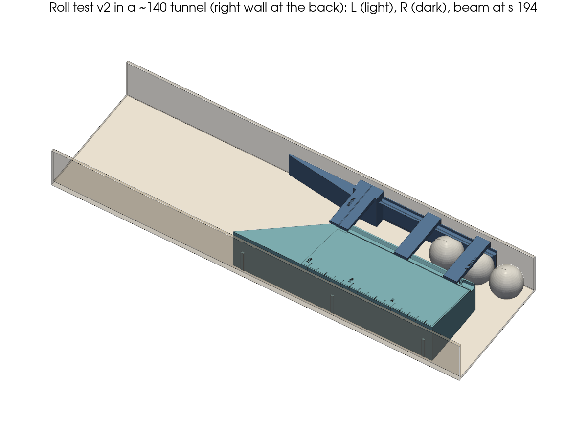
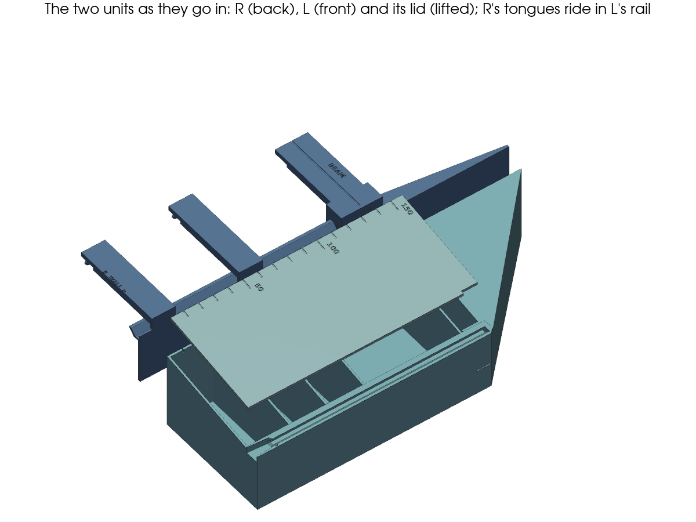
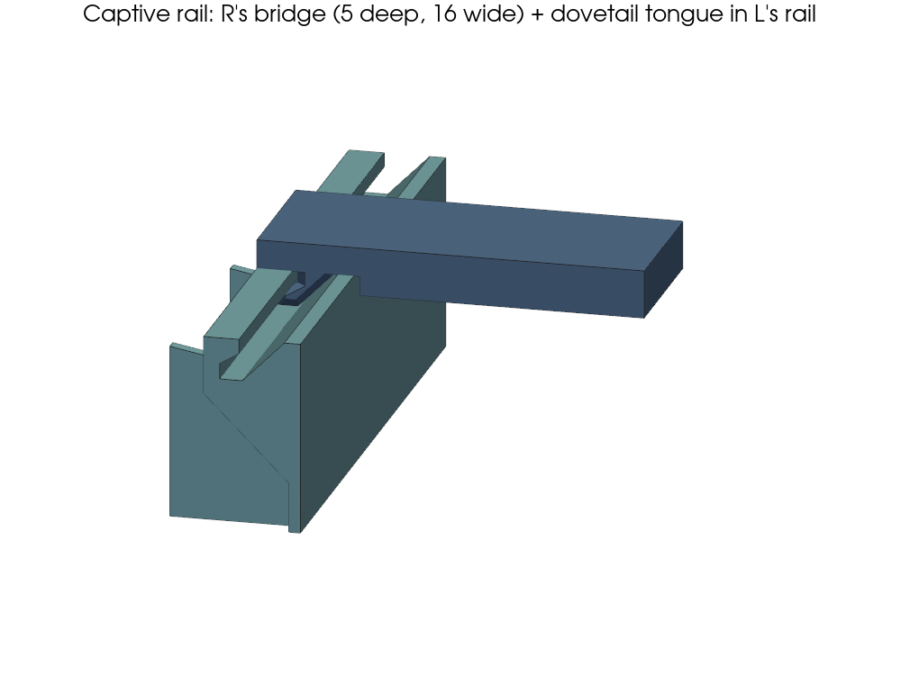
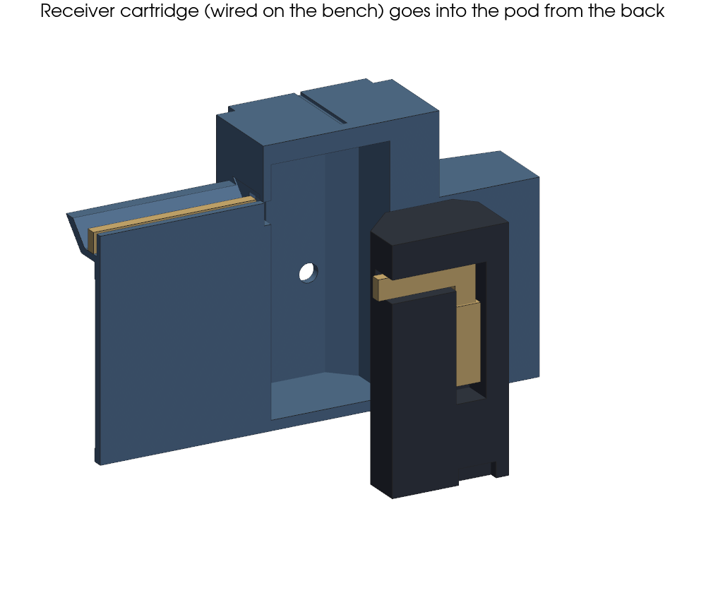
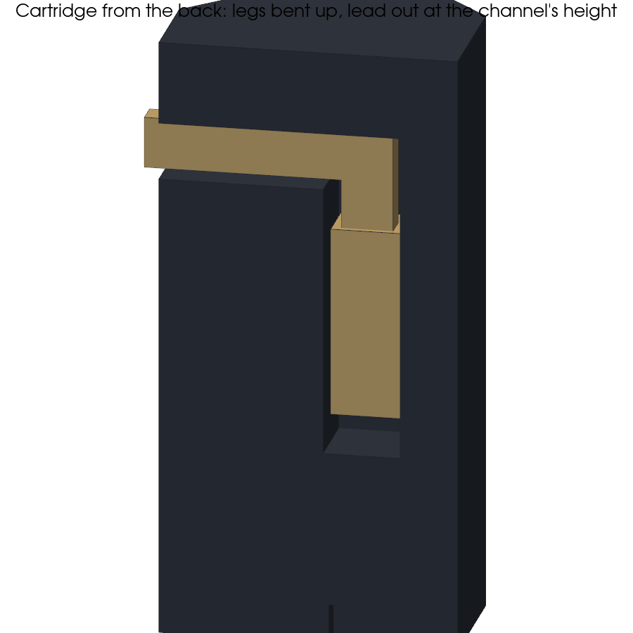
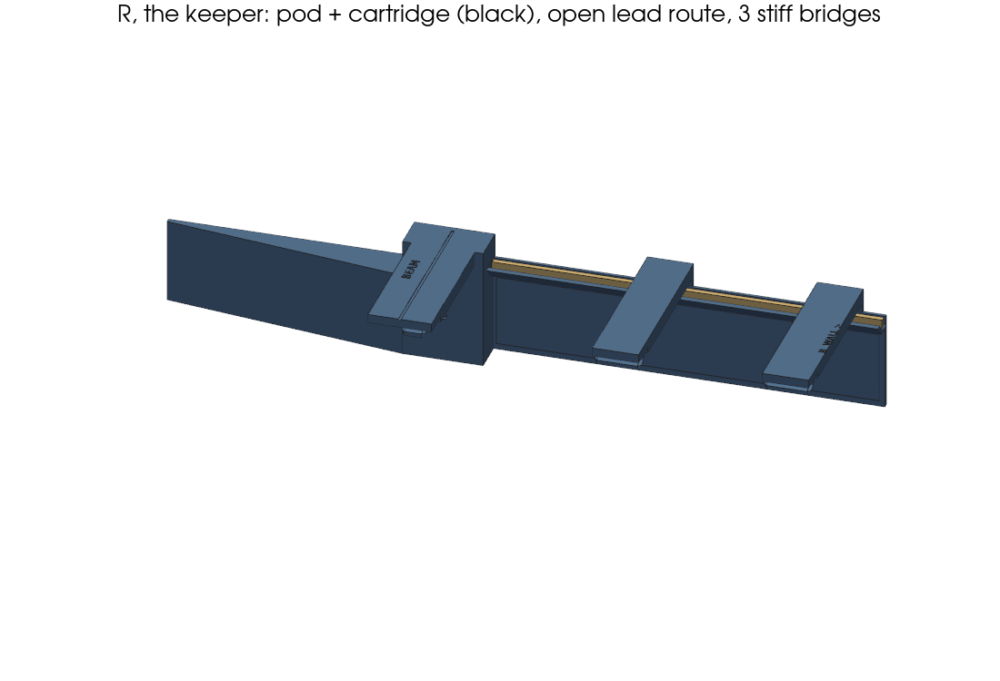

# Roll test v2: fit-1 fixes + receiver cartridge (mechanical, 2026-10-16)

> **Update (user's markup, team/drawings/roll-test-1/v2-markup.png):**
> - The cartridge now goes in **from the back**, through a window in R's skin, and stops at the pod's face wall.
>   The tunnel's right wall holds it in, and R still prints on that face. The light tube in front of the tip is
>   unchanged. The lead leaves at the channel's height through a notch in the end wall, open at the back, so the
>   ramp and the opening in the pod top are gone (the strap is whole again).
> - **L has a lid** over its box, in the roof's plane. It's a flat print (+22 cm³) resting on the cross walls, and the
>   scale is on it now.
> - The red line in the markup is the lead route (lead's answer is right).
> - **Fit coupon, smaller (lead/user):** `out/roll_test_coupon.3mf`, 3D view as it prints `out/roll_test_coupon_3d.png`.
>   coupon_L is 25 mm of L's rail on a 2 mm foot, upright (25 × 10 × 10, 1.9 cm³). coupon_R is R's mid tongue on an 8 mm
>   stub of the deep bridge and a 1.6 pad, lying on the pad (print 20 × 12 × 20.2, 1.8 cm³). Both are cut from the real
>   parts in their real print orientation (same print Z and 45° overhangs; the pad sits a whole number of 0.2 layers
>   above R's skin), with the same 0.35 clearance. ~3.7 cm³, ~8 min EST plus warm-up. Self-check: it slides at 0/5/15/25 out,
>   a 0.5 lift hits, a sideways shift of 0.65 hits (mutation-tested).
> - **Coupon 1 (photos team/drawings/coupon-1/):** the spaghetti is the tongue's −y foot on **coupon_R**. With R lying on
>   its skin, that side faces down: a 1.5 mm flat ledge plus 1 mm of foot over a 2.6 mm gap. The same face is on all three
>   of R's real tongues (one shared profile); coupon_L and the real L were fine. **Fix (in both):** the tongue hooks on +y only,
>   and the −y side is a 45° slope from root to tip (L's groove follows it). Depth 4 → 4.5 (user: "extend the male part"),
>   floor gap 0.35, clearance 0.35. New self-check: no coupon face more than 45° from vertical as it prints. It fails on the
>   old profile and on a steeper slope; lift-out still fails at 0.6 clearance. Volume ~3.8 cm³.
> - **Coupon 2 "lifts straight out" (user):** a check confirmed that the coupon and the real R were free along a 45° diagonal
>   (up and toward the channel, more than 8 mm) and could roll out at -5°. The 45° hook face was parallel to the 45° slope,
>   so R slid along both. With R on its skin and L upright, every face at ≤ 45° leaves that diagonal open. A hook on R's
>   down-facing side always starts in mid-air (coupon 1). **Coupon 3:** a single hook, 2 mm overlap (1.65 beyond the
>   0.35 clearance), its face 30° from horizontal. R stays support-free; only L's lip overhangs 60° (Bambu's default
>   limit). Depth 4, floor gap 0.35. Self-check: a 1.0 lift, both diagonals (1, 1) and a ±5° roll about either rail edge all
>   hit L, for the coupon and the real R. The overhang check allows only L's lip past 45° (≤ 60°). Each check was
>   mutation-tested (45° hook, 0.5 overlap, 20° hook). End view out/roll_test_coupon_end.png.
> - **Coupon 3 works (user); one end stuck on a seam.** No slicer is installed here, so "Aligned" can't be predicted
>   (it picks corners, and the groove's inside corners are likely). With seam **"Back"**, each loop's seam goes to its
>   rearmost point. A new self-check slices every part on every plate at 0.2 mm layers and fails if any loop's rearmost
>   point is on a groove or tongue face. That needs R and the coupons with s along the bed's Y axis: at 0° R had 93 such
>   loops, at 31° 64, at 31° off Y 3, at 90° 0. In some layers R's hook wing is an island, and with +z at the back its seam
>   sat on the hook face. L is clean at any angle (one loop; its rearmost point is the left wall). So R goes front to back
>   on plate 1 and the one plate (3 mm edge, no brim), and so does L on the one plate. **1 mm lead-ins** at both ends of all
>   tongues, the coupon's rail ends and where L's lips start (after the funnel). The lead-in faces are ≤ 51°, within the
>   lip's 60°. Roll play is ~5° (clearance), so the check now uses 6°. No new coupon is needed.
> - **One-plate review (user), supports off.** A new self-check fails on any face past 45° that is not a bridge (≤ 10 on R
>   and the cartridge, ≤ 16 under L's roof) with material past both ends, or ≤ 1 mm across (engravings). It runs on all
>   three parts as they print. It flagged 10 faces on the old model. **R:**
>   - The cartridge pocket's roof spanned 19 × 38. Two 45° fillets in its corners (6 and 3.5; the smaller one clears the
>     Ø3 tube) cut the span to 9.5. The cartridge's front corners are cut to match, and its crush ribs moved back behind
>     them, so they now bite only in the last ~5 mm.
>   - The lead channel's outer wall hung 3.4 over the groove; it now leans out at 45°. It is still ≥ 0.7 clear of a
>     36 mm ball (unchanged).
>   - The pod's walls above the skin started in mid-air; the skin now runs up behind the pod.
>   - The window and the notch are fine (the window sits on the bed, the notch is a 3.6 bridge).
>   **L:**
>   - The triangle was a leftover. The ball-path cut went only up to V_MIN, so the emitter dummy's top and the rail's end
>     (z 37–40) stuck out past the V-wall, starting in mid-air. The cut is now full height.
>   - Also fixed: the roof's first bay had a free front edge (now a wall under it), and the slide ribs started 2 up in
>     mid-air (now a 45° underside).
>   The 3 taps are unchanged. Each fix was mutation-tested. Renders: out/roll_test_pod_3d.png, out/roll_test_roof_3d.png.
> - **Roll test v2 printed (2026-10-17, DECISIONS):** reprint **plate 1 only** (R + cartridge); L is unchanged (its STL
>   is byte-identical).
>   - **Cartridge fit:** the crush ribs are gone, with 0.2 clearance per side (s and z). The cartridge now stops on the
>     pocket's 45° fillets, so its front is 0.65 short of the bridged roof (it sagged) and its back seats 0.3 under the
>     skin's face (it stood proud).
>   - **Front bridge:** its tongue was s 44–60, but L's rail only hooks from s 51 (the 14 open funnel + the 1 lead-in), so
>     just 8 of its 16 mm engaged. The bridge moved 8 toward the goal, and the tongue is now s 52–68, all in the full profile.
>   - Self-check: the cartridge is ≥ 0.2 clear per side; seated, it is ≥ 0.5 under the roof and 0–0.3 under the skin; the
>     front tongue is past the funnel. All are mutation-tested. Renders out/roll_test_pocket.png, out/roll_test_front_bridge.png.
> - Renders: out/roll_test_parts.png, out/roll_test_cartridge.png.

Asks: lead's QUESTION (receiver install) and ACTION (DECISIONS 2026-10-16, "roll-test fit, first try"; photos
`team/drawings/roll-test-1/fit-1..4.jpg`). Model `roll_test.py` (v2); procedure `ROLL-TEST.md`; self-check passes; the
new asserts are mutation-tested (each one fails when its feature is broken); assembly gate 66 / 0.

## Reprint: yes, R once (+ L)

- **R must be reprinted.** The cartridge needs a pocket with a floor and an opening in the pod top, and the old boss
  has to go. Fit 1 also needs dovetail tongues and deeper bridges. Both are in **one** R print:
  `out/roll_test_plate1.3mf` = R + cartridge.
- **L must be reprinted too** (80 shorter, no wiper, taller, dovetail rail). It's now one piece: `out/roll_test_plate2.3mf`
  = L + wedge. The two plates are laid out for a 256 bed (≥ 10 to the edge and between parts; top views
  `out/roll_test_plate1.png`, `plate2.png`). Everything doesn't fit on one plate (R and L both need an angle). The lid is
  `out/roll_test_lid.3mf`, for later: the test runs without it. Supports off.
- Size: ~140 cm³ solid in all, ~110 g with 3 walls, ~3 h (EST). The cartridge is ~7.5 cm³: print it in **black**.

## Fit-1 items

| # | User | Done | Check that guards it |
|---|---|---|---|
| 1 | R lifts out of L's slot | **Dovetail rail** on L (10 wide, 45° flanks, 0.35 clearance per side; 14 mm open-top funnel at the mouth; fit coupon `out/roll_test_coupon.3mf`), dovetail tongues under R's three bridges; the widened mouth at L's front stays | R lifted 0.5 hits L; R slides 5/60/150 free; in-stop; gate held ±0.5 |
| 2 | L 80 shorter | L s 36–275 (was 36–356), **one print** (239 long, no pins). Beam **240 → 194**, V-wall **45°** (lead; the queue starts at the frame's bar, s ≈ 33) | tip ≤ 276.5; queue ≥ 4 × 36 |
| 3 | Remove the wiper | Gone. The float is set by **3 slide ribs, 2 mm**, on L's left face (lead: widen L by 2): ~2.5 left of the ~4.5 spare | float 1.5–2.5 |
| 4 | V-wall/roof taller | V-wall ≥ **37** everywhere (> a 36 ball), the roof over the whole area behind it, from 52 at L's left wall falling to the V-wall (5°). L is **44** high, the most the tunnel's 46 EST allows (the opening would allow 47) | V-wall ≥ 37; roof covers L; height vs step, opening and roof |
| 5 | 4–5 mm spare | Read as a measurement (lead): tunnel ≈ **139.5 EST** (§0 updated), sled 135 + 2 ribs | as #3 |
| 6 | Stiffer bridges | Front/mid bridges 10 → **16 wide**, and **5 deep** over the channel (down to z 38, 2 above a 36 ball) → **~7× stiffer**. The strap is deep over the gate | ≥ 5× stiffer; 31/36 balls pass under |

## Beam 194 (45° V-wall): what it costs

- **Why 45°:** the wooden floor is ~10 *below* the frame's bar (user), so waiting balls rest against the bar at
  s ≈ 33 EST, not down in the tube. A 35° wall (beam 160) would leave room for only 3 × 36.
- **Queue clear of the beam:** 4 × 36 (the 4th's back at 177) or 5 × 31. That meets the firmware's N ≥ 4.
- **Rebound room:** **~17 mm past 4 queued balls, ~53 past 3** (was ~80 / ~115). Video 1 showed ~0 rebound at
  ~0.6 m/s. **Roll tests 1 and 4 watch the 45° wall**: a slow ball must still roll on, and a hard one must not bounce
  back into the beam. The pod's downstream face still stops a wall-hugging rebound ~14 short of the beam.
- **Travel time:** +46 mm of roll to the beam, ≈ +0.05 s from landing to the count (§0's 0.24 s is beam to sound,
  so it's unchanged).
- **R is 249 long** (s 44–293), still one print.

## Receiver cartridge (lead's question)

 

- **Bench, not the pod:** the TEFT4300 sits in a separate block (19 × 11 × 41): bore, flange seat, and the closed Ø3
  light tube in front of the tip. Glue the flange. Bend the legs 90° **up** in a 4.8 × 3.8 groove behind the flange,
  then solder and shrink. This is electronics' envelope (pair ≤ 4.4 × 3.5, stiff 11 mm), and it's asserted.
- **In:** drop it into the pod **from the top** onto a pocket floor, flush with R's top. Its tip ends up 4 mm behind
  the Ø3 aperture at z 17. 4 crush ribs (0.15) hold it. To take it out, push it up with a pen through the floor hole.
- **Lead:** the route is open all the way: up the cartridge's back (the skin closes the groove), along its top, through
  a notch over the pod's end wall, down a 30° ramp into the U-channel, and sideways in under the bridges (3.8 high gap).
  Nothing is threaded, so the Dupont housing goes on at the bench. Electronics agreed (`electronics/receiver-cartridge-leads-2026-10-16.md`).
- **Ball path unchanged:** the pod face, the aperture, the lead-in and the skin are the same. Straight legs would need a
  ~17 deep pod, which would cost the lead-in, so we kept bent legs.

## Open / EST

- **Wire OD:** sized for **2 × Ø1.6 stacked** (electronics, 2026-10-16: 26 AWG fallback jumpers). The channel and the
  cartridge's top groove are 3.4 deep, and the channel is 4.4 high. No measurement is needed.
- **L = 52** (update, lead/user): the ~55 frame opening is the limit (the wooden floor is ~10 *below* the frame's bar, so a
  unit slides in over the bar and drops down). To check the tunnel height, put the wedge between L's roof (52) and the tunnel roof.
- **With no wiper, R's tip** (s 293) can sit ≤ 2.5 off the right wall. A wall-hugging ball meets it off-centre and is
  deflected into the channel. The new **roll test 8** checks that.
- The cartridge's crush ribs and the dovetail clearance are first-print guesses. ROLL-TEST.md says what to scrape or tape.
